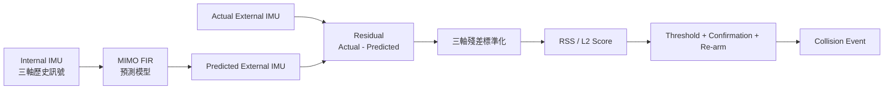

# 雙 IMU 碰撞感測演算法：MIMO FIR、Ridge Regression 與 RSS Score

[TOC]

---

## 1. 問題與整體思路

單顆 IMU 容易同時量到 Robot 正常運動、機構振動與碰撞訊號；直接將兩顆 IMU 的三軸資料相減，也可能因安裝軸向、尺度、傳遞延遲及交叉軸耦合而得到很低的碰撞特徵 SNR。

目前方法不是直接相減，而是先學習正常運動時兩顆 IMU 之間的動態關係：



這套方法包含三個不同層次：

| 層次 | 方法 | 功能 |
|---|---|---|
| 預測模型 | MIMO FIR | 學習正常狀態下 Internal IMU 到 External IMU 的動態映射 |
| 訓練方法 | Ridge Regression | 從資料求出 FIR kernel 與 bias |
| 碰撞判斷 | 標準化 residual + RSS | 衡量目前訊號偏離正常狀態的程度 |

---

## 2. MIMO FIR 模型

### 2.1 FIR 是模型結構

目前的預測模型可寫成：

$$
\hat{\mathbf E}(t)
=
\mathbf b+
\sum_{\ell=0}^{L-1}
\mathbf W_{\ell}\mathbf I(t-\ell)
$$

其中：

- $\mathbf I(t)$：Internal IMU 的三軸輸入。
- $\hat{\mathbf E}(t)$：預測的 External IMU 三軸輸出。
- $\mathbf W_{\ell}$：第 $\ell$ 個時間延遲的 $3\times3$ 權重矩陣。
- $\mathbf b$：External X、Y、Z 的三個 bias。
- $L$：FIR tap 數量。

這個 FIR kernel 與 bias 是由資料學得的，所以稱為「濾波器」在數學上沒有錯；但從系統功能來看，更精確的名稱是「學習式動態預測模型」或「系統辨識模型」，而不是一般只為了平滑雜訊的低通濾波器。

### 2.2 $3\times3\times L$ 三維係數陣列

Kernel 的索引可表示為：

$$
W[\text{output axis}][\text{input axis}][\text{tap}]
$$

也就是：

$$
\mathbf W\in\mathbb R^{3\times3\times L}
$$

以輸出軸來看，共有三組模型：

$$
\hat E_x=b_x+W_{xx}*I_x+W_{xy}*I_y+W_{xz}*I_z
$$

$$
\hat E_y=b_y+W_{yx}*I_x+W_{yy}*I_y+W_{yz}*I_z
$$

$$
\hat E_z=b_z+W_{zx}*I_x+W_{zy}*I_y+W_{zz}*I_z
$$

因此有兩種等價說法：

- 三組輸出 kernel，每組大小是 $3\times L$。
- 九條 input-output FIR 路徑，每條長度是 $L$。

若 $L=20$，模型包含 $3\times3\times20=180$ 個 kernel 係數，再加上 3 個 bias。

### 2.3 為什麼軸向不同仍可學習

完整的 $3\times3$ 權重矩陣允許每個 External 輸出軸同時使用 Internal X、Y、Z。例如 External X 不只使用 Internal X，也能使用 Internal Y、Z。因此模型可以從成對資料學習固定的：

- 軸向旋轉關係。
- 三軸尺度差異。
- 交叉軸耦合。
- 各軸不同的時間響應。
- 固定 bias。

這代表通常不必先把兩顆 IMU 的同名軸人工旋轉到完全一致，並不代表完全不需要校正或資料條件。模型仍要求：

- 兩顆 IMU 時間同步。
- 安裝相對關係在訓練與部署期間固定。
- 軸順序、正負方向、單位與取樣率正確。
- 訓練資料包含足夠的三軸激振。
- 若感測器尺度或安裝狀態改變，必須重新驗證或訓練。

### 2.4 History $H$ 與 Tap $L$

History $H$ 是 FIR 向前觀察的時間長度，Tap $L$ 是這段時間內的樣本數。若 $H$ 以秒表示、取樣率為 $f_s$：

$$
L\approx Hf_s
$$

例如 $f_s=1000\text{ Hz}$、$H=20\text{ ms}=0.02\text{ s}$：

$$
L=0.02\times1000=20
$$

模型會使用 $I(t),I(t-1),\ldots,I(t-L+1)$ 進行一次預測。這是 FIR 單次預測使用的視窗，不是整段機器學習訓練資料的長度。

Ridge Regression 不會自行決定 $H$ 或 $L$。外層的參數搜尋先指定候選 $H$，再針對每個候選模型訓練 kernel 與 bias。

### 2.5 為什麼目前使用 FIR 而不是 IIR

| 比較 | FIR | IIR |
|---|---|---|
| 使用的歷史 | 歷史輸入 | 歷史輸入與歷史輸出 |
| 是否遞迴 | 否 | 是 |
| 穩定性 | 沒有輸出回授，容易保證 | 必須限制極點與回授係數 |
| 部署驗證 | 較直接 | 需額外處理初始狀態與數值穩定性 |
| 係數數量 | 長記憶通常需要較多 taps | 可用較少係數描述長時間響應 |

目前優先選擇 FIR，是因為它可解釋、容易訓練、沒有輸出回授造成的發散風險，且 ESP32 上只需要固定次數的乘加運算。若未來確認必須用較少係數描述很長的動態記憶，才需要評估 IIR 的效益與穩定性成本。

---

## 3. Ridge Regression 訓練

### 3.1 模型與訓練方法不可混為一談

MIMO FIR 是「要被訓練的模型結構」；Ridge Regression 是「求模型參數的方法」。

```text
選定 History H / Tap L
        ↓
建立 3×3×L MIMO FIR 結構
        ↓
Ridge Regression 使用成對 IMU 資料求 W、b
        ↓
輸出 kernel[3][3][L] 與 bias[3]
```

### 3.2 Ridge 的目標函式

三軸原始預測殘差為：

$$
e_x=E_x-\hat E_x,\qquad
e_y=E_y-\hat E_y,\qquad
e_z=E_z-\hat E_z
$$

資料誤差可表示為：

$$
MSE=
\frac{1}{3N}
\sum_{t=1}^{N}
\left[e_x(t)^2+e_y(t)^2+e_z(t)^2\right]
$$

Ridge 再加入 L2 係數懲罰：

$$
Loss_{\text{Ridge}}
=MSE+\alpha\|\mathbf W\|_2^2
$$

它要求正常運動的預測誤差小，同時避免 FIR 係數大得不合理。

### 3.3 為什麼需要 Ridge

MIMO FIR 的特徵高度相關：

- 相鄰 taps 的輸入非常相似。
- IMU 三軸可能同時受到同一機械振動影響。
- $L$ 越長，待估係數越多。

普通最小平方法可能得到一組很大的正負係數互相抵消，在訓練資料上誤差很小，但對新資料與雜訊很敏感。Ridge 的 L2 正則化會抑制過大的係數，使模型較穩定並降低過擬合。

超參數 $\alpha$ 控制取捨：

| $\alpha$ | 可能結果 |
|---|---|
| 太小 | 接近普通最小平方法，係數可能過大、過擬合 |
| 適中 | 保留有效動態，同時提升穩定性 |
| 太大 | 係數被過度壓小，造成欠擬合 |

### 3.4 三軸 Loss 與三組 kernel

三軸各自都有 residual，也能分別檢查 $MSE_x$、$MSE_y$、$MSE_z$，以確認哪一軸預測較差。模型選擇時通常使用三軸與所有時間點的合併 MSE。

Kernel 則是三組輸出模型，每組輸出都包含三條輸入軸 FIR。這不等於每個輸出軸只有一條長度 $L$ 的 kernel。

### 3.5 參數搜尋流程

外層最佳化可以測試多組：

$$
H\in\{H_1,H_2,\ldots\},\qquad
\alpha\in\{\alpha_1,\alpha_2,\ldots\}
$$

對每一組 $(H,\alpha)$：

1. 將 $H$ 換算為 Tap $L$。
2. 建立對應長度的 MIMO FIR 特徵矩陣。
3. 使用 Ridge 求出 $W$ 與 $b$。
4. 計算保留資料的 prediction MSE。
5. 選擇泛化誤差較低的參數組合。

Fixed Grid 與最佳化模式在設計上應共用相同的碰撞 Score 定義；最佳化模式應選模型超參數，而不是任意更換執行期 Score 的物理意義。實際版本仍應以目前程式與規格再次確認。

---

## 4. L1、L2 與其他訓練方法

### 4.1 L1 與 L2 名稱的由來

$L_p$ norm 的一般形式為：

$$
\|\mathbf w\|_p
=
\left(\sum_j|w_j|^p\right)^{1/p}
$$

L1 norm：

$$
\|\mathbf w\|_1=\sum_j|w_j|
$$

L2 norm：

$$
\|\mathbf w\|_2=\sqrt{\sum_jw_j^2}
$$

Ridge 使用 squared L2 penalty：

$$
\|\mathbf w\|_2^2=\sum_jw_j^2
$$

雖然公式沒有開根號，仍稱為 L2 regularization。L2 傾向讓所有係數縮小但通常不會精確變成 0；L1 則較容易產生為 0 的稀疏係數。

### 4.2 可替代的訓練方法

| 訓練方法 | 主要特性 | 可訓練的模型 |
|---|---|---|
| Ordinary Least Squares | 最小化平方誤差，沒有正則化 | 線性迴歸、FIR、MIMO FIR、ARX |
| Ridge Regression | L2 正則化，抑制過大係數 | 線性迴歸、FIR、MIMO FIR、固定特徵的線性模型 |
| Lasso | L1 正則化，可產生稀疏係數 | 線性迴歸、稀疏 FIR、特徵選擇模型 |
| Elastic Net | 同時使用 L1 與 L2 | 特徵多且高度相關的線性模型、FIR |
| RLS | 收到新資料時遞迴更新係數 | 線性迴歸、自適應 FIR、MIMO FIR、ARX |
| LMS／NLMS | 低成本逐筆梯度更新 | 自適應 FIR、MIMO FIR、線上系統辨識 |
| Gradient Descent／Adam | 以梯度反覆更新可微分參數 | 線性模型、FIR、CNN、RNN、LSTM 等 |

Ridge 不是「線性遞迴」方法，而是通常以批次資料求解、帶 L2 正則化的線性迴歸。RLS 才是線性模型的遞迴係數更新方法。

---

## 5. Training Loss 與碰撞 Score

### 5.1 兩者是不同問題

| 項目 | Ridge Training Loss | Collision Score |
|---|---|---|
| 使用時機 | Python 訓練期間 | ESP32 即時執行 |
| 使用資料 | 全部訓練樣本的原始 residual | 當下的標準化 residual |
| 計算 | 三軸平方誤差的平均加 L2 penalty | 三軸平方和開根號 |
| 目的 | 學習與選擇預測模型 | 判斷當下異常程度 |
| 數值方向 | 越低越好 | 越高越異常 |

訓練 Loss 不是把三軸標準化 residual 做 RSS。正確順序是先用原始預測誤差訓練模型，模型完成後才從正常 residual 建立中心與尺度，供即時判斷使用。

### 5.2 Residual 的定義

$$
\mathbf e(t)
=
\mathbf E_{actual}(t)-\hat{\mathbf E}(t)
$$

也就是實際 External IMU 減去 MIMO FIR 所預測的 External IMU。

---

## 6. 殘差標準化公式的由來

### 6.1 為什麼減去平均值

令正常 residual 為 $e$，且 $E[e]=\mu$。希望平移後的變數 $e_c=e-a$ 平均值為 0：

$$
E[e-a]=E[e]-a=\mu-a=0
$$

因此：

$$
a=\mu,\qquad e_c=e-\mu
$$

減去平均值會移除正常狀態本來就存在的固定 residual bias，使 0 代表正常中心。

### 6.2 為什麼除以標準差

再令 $z=e_c/b$，並要求 $Var(z)=1$：

$$
Var\left(\frac{e-\mu}{b}\right)
=
\frac{\sigma^2}{b^2}
=1
$$

因此 $b=\sigma$，得到 Z-score standardization：

$$
z=\frac{e-\mu}{\sigma}
$$

標準化後通常有：

$$
E[z]\approx0,\qquad Std(z)\approx1
$$

$z=3$ 的意義是目前 residual 距離正常中心約 3 個正常標準差，而不是原始加速度等於 3。

若只做 $e/\sigma$，嚴格來說只是尺度縮放；只有在已知 $\mu=0$ 或先完成中心化時，才能視為完整標準化。

### 6.3 為什麼三軸都要標準化

若直接計算原始 residual 的平方和，正常雜訊較大的軸容易主導 Score。分軸標準化後，每個軸貢獻的是「相對於自身正常波動的異常程度」。

實作上還需要：

- 使用正常、無碰撞資料估計 $\mu_i$ 與 $\sigma_i$。
- 為 $\sigma_i$ 設定最小值，避免除以零或放大微小雜訊。
- 確認訓練與部署的量測單位、取樣率與安裝條件一致。

目前逐軸標準化只使用三個標準差，沒有處理三軸 residual 的相關性。若三軸高度相關，更完整的方法是以共變異數矩陣做 whitening，並使用 Mahalanobis distance。

---

## 7. Root Sum of Squares 碰撞判斷

三軸標準化 residual 為：

$$
z_x=\frac{e_x-\mu_x}{\sigma_x},\qquad
z_y=\frac{e_y-\mu_y}{\sigma_y},\qquad
z_z=\frac{e_z-\mu_z}{\sigma_z}
$$

碰撞 Score 為：

$$
Score(t)
=
\sqrt{z_x(t)^2+z_y(t)^2+z_z(t)^2}
=
\|\mathbf z(t)\|_2
$$

這是 Root Sum of Squares、L2 norm 或 Euclidean norm。它不是 RMSE，因為沒有除以軸數 3：

$$
RMSE=\sqrt{\frac{z_x^2+z_y^2+z_z^2}{3}}
$$

Score 是單一時間點的連續異常程度。事件通常還需要：

1. Score 超過 threshold。
2. 滿足 confirmation，例如連續命中或指定視窗內命中次數。
3. 使用 re-arm／refractory period，避免同一次碰撞重複觸發。

Threshold 應由正常資料與碰撞資料的誤報、漏報、觸發延遲取捨決定，而不是只根據單筆訊號人工猜測。

---

## 8. ESP32 部署

Python 訓練完成後，ESP32 不再執行 Ridge Regression，只載入已學得的常數：

```c
static const float kernel[3][3][L];
static const float bias[3];
static const float residual_center[3];
static const float residual_scale[3];
```

`kernel[output][input][tap]` 中的 `output` 用來選擇目前要預測 External X、Y 或 Z 的那一組係數。若移除 output 維度，三個輸出軸就會被迫共用相同係數，無法表達軸向旋轉與交叉軸關係。

推論概念如下：

```c
for (int output = 0; output < 3; output++) {
    predicted[output] = bias[output];

    for (int input = 0; input < 3; input++) {
        for (int tap = 0; tap < L; tap++) {
            predicted[output] +=
                kernel[output][input][tap] *
                internal_history[input][tap];
        }
    }
}
```

接著計算：

```c
for (int axis = 0; axis < 3; axis++) {
    residual[axis] = actual_external[axis] - predicted[axis];
    z[axis] = (residual[axis] - residual_center[axis])
            / residual_scale[axis];
}

score = sqrtf(
    z[0] * z[0] +
    z[1] * z[1] +
    z[2] * z[2]
);
```

若 $L=20$，推論模型包含 180 個 kernel 係數與 3 個 bias；每次三軸預測的主要運算量是 $3\times3\times L$ 次乘加。

---

## 9. 任務、模型與訓練方法的分類

### 9.1 三個分類層次

```text
任務：要解決什麼問題
  ↓
模型：用什麼函式表示輸入輸出關係
  ↓
訓練方法：如何從資料求出模型參數
```

Regression、Classification、Clustering 是任務；MIMO FIR、神經網路、決策樹是模型；Ridge、RLS、Adam 是訓練或最佳化方法。

### 9.2 常見機器學習任務

| 任務 | 輸出 | 例子 |
|---|---|---|
| Regression | 連續數值 | 預測 External IMU 三軸加速度 |
| Classification | 離散類別或機率 | 碰撞／非碰撞 |
| Clustering | 沒有預先標籤的群組 | 將振動型態自動分群 |
| Anomaly Detection | 異常程度或異常標記 | 判斷目前 residual 是否偏離正常狀態 |

目前系統先使用 MIMO FIR 做多輸入、多輸出的時間序列 Regression／System Identification，再使用標準化 residual 的 RSS 進行 Anomaly Detection，最後用 threshold 與確認規則產生碰撞／非碰撞事件。它不是直接用碰撞標籤訓練分類器。

### 9.3 模型結構與適合情境

| 模型結構 | 線性／非線性 | 時間記憶方式 | 適合情境 |
|---|---|---|---|
| FIR／MIMO FIR | 線性 | 固定長度歷史輸入，無輸出回授 | 可用線性動態近似，要求穩定、可解釋、容易部署到 MCU |
| IIR | 線性 | 歷史輸入與歷史輸出回授 | 需要較少係數描述長時間響應，並能控制穩定性 |
| Feedforward Neural Network | 非線性 | 通常沒有內部時間狀態 | 輸入輸出存在非線性，但不需要遞迴記憶 |
| CNN／TCN | 非線性 | 固定時間視窗卷積 | 波形包含局部脈衝、振動或多時間尺度特徵 |
| RNN／LSTM／GRU | 非線性 | 內部遞迴狀態 | 長時間相依，固定 FIR 視窗不足 |
| 分段線性模型 | 多個線性模型 | 各操作區間各有參數 | 不同速度或姿態差異明顯，但區間內可線性近似 |

### 9.4 線性、非線性與遞迴是不同概念

線性／非線性描述模型的數學映射；遞迴／非遞迴描述是否使用歷史輸出、內部狀態或持續更新結果。

| 模型 | 線性／非線性 | 遞迴特性 |
|---|---|---|
| MIMO FIR | 線性 | 非遞迴，但使用歷史輸入 |
| IIR | 線性 | 使用歷史輸出回授 |
| Feedforward Neural Network | 通常非線性 | 非遞迴 |
| RNN／LSTM | 通常非線性 | 有內部遞迴狀態 |

真實 Robot 可能包含摩擦、背隙、飽和與姿態相關等非線性，但在固定安裝與有限操作範圍內，仍可能以線性 MIMO FIR 得到足夠準確的局部近似。是否需要神經網路，應以跨速度、姿態與 Robot 條件的驗證誤差判斷，而不是只因真實物理世界存在非線性就直接採用複雜模型。

---

## 10. 報告重點與驗證項目

對主管可用以下方式總結：

> 系統不是直接相減兩顆 IMU，而是先用 Ridge Regression 從正常資料學出 $3\times3\times L$ MIMO FIR kernel 與三個 bias。ESP32 使用固定係數預測 External IMU，再把實際值與預測值的 residual 標準化，透過三軸 RSS Score、threshold 與確認條件輸出碰撞事件。

需要特別驗證：

- 不同 Robot、速度、姿態、碰撞方向與擦撞偏移。
- 正常運動的誤報率與碰撞事件的漏報率。
- 觸發延遲與 confirmation／re-arm 對延遲的影響。
- 三軸個別 validation MSE，避免單一軸預測明顯較差。
- 訓練與部署時的取樣率、單位、安裝與時間同步一致性。
- History $H$、Ridge $\alpha$、threshold 的泛化能力。
- Fixed Grid 與最佳化模式是否確實使用相同的 residual normalization 與 L2 Score 定義。

---

## 11. 核心結論

1. MIMO FIR 是線性、非遞迴但具有有限時間記憶的預測模型。
2. Ridge Regression 是訓練方法，不是 FIR 本身；它在指定 $H/L$ 下求出 kernel 與 bias。
3. $3\times3\times L$ 表示三個輸出軸、三個輸入軸與 $L$ 個時間 taps，共九條 FIR 路徑。
4. 完整 $3\times3$ 映射可學習固定軸向差異，但仍要求同步、固定安裝與正確單位。
5. Training Loss 是三軸原始 prediction MSE 加 L2 penalty；不是碰撞 RSS Score。
6. 標準化公式 $(e-\mu)/\sigma$ 的目的，是移除正常中心並將各軸轉成相對正常波動的無因次尺度。
7. RSS 是標準化三軸 residual 的 L2 norm，不是 RMSE。
8. Python 負責訓練；ESP32 只執行固定 kernel 的 FIR 推論、標準化與事件判斷。
9. Regression、Classification、Clustering 是任務；模型結構與訓練方法是另外兩個分類層次。

###### tags: `Dual IMU` `Collision Detection` `MIMO FIR` `Ridge Regression` `ESP32` `Machine Learning`
