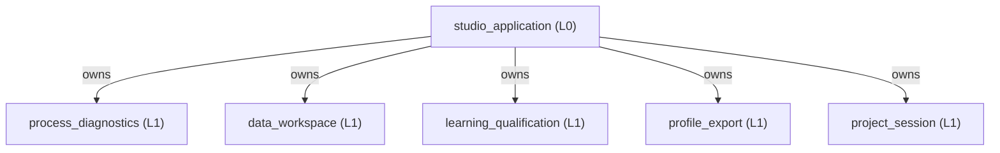
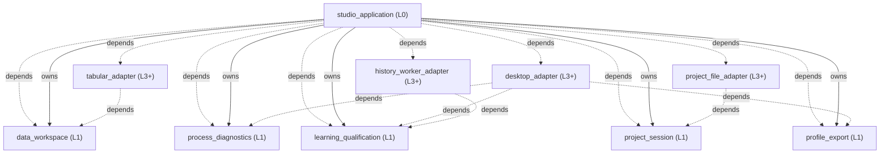

<!-- GENERATED BY govern-modular-event-architecture; DO NOT EDIT -->

# dual-imu-collision-studio Architecture Guide

- Standard: `2.2.0`
- Schema: `2.2.0`

## System Purpose and Entrypoints

- `studio_application` — Compose the desktop workflow, own annotation edit history, map immutable results between sibling domains, coordinate durable project reopen/save, and dispatch recording-only Replay evidence and model artifacts to bounded background exports.
  - Entrypoints: [`main`](../src/dual_imu_collision_studio/app.py) (function)

## Main Function Tree

## Function Guide

### `studio_application`

- **Purpose:** Compose the desktop workflow, own annotation edit history, map immutable results between sibling domains, coordinate durable project reopen/save, and dispatch recording-only Replay evidence and model artifacts to bounded background exports.
- **Children:** `process_diagnostics`, `data_workspace`, `learning_qualification`, `profile_export`, `project_session`
- **Related Flows:** [`manage-project`](generated/studio_application.md#manage-project), [`record-process-diagnostics`](generated/studio_application.md#record-process-diagnostics), [`prepare-workspace`](generated/data_workspace.md#prepare-workspace), [`export-replay-csv`](generated/studio_application.md#export-replay-csv), [`export-model-txt`](generated/studio_application.md#export-model-txt)
- **Protection Rationale:** Sibling domains communicate only through application-owned mappings.; Exactly one release composition root exists.; The QML engine retains the StudioController for the complete main-window lifetime.; QML coordinates are converted to sample indexes before domain validation.; Provisional annotation edits never enter Learning until the complete set is confirmed.; The application owns the session-local speed-to-template registry while data_workspace owns template semantics and projection.; The application restores its session-local manual annotation identity allocator above every persisted manual annotation identity before accepting post-open edits.; Successful reference activation clears both the primary selected annotation index and the selected-annotation set before publishing the refreshed UI state.; The application maps sibling-owned workspace and Profile values into project_session-owned persistence values without exposing JSON representations to functional domains.; Replay CSV export snapshots one selected recording and candidate, computes the complete continuous recording exactly once, and streams Learning-owned ReplayEvidence off the UI thread without display normalization.; Model TXT export snapshots one candidate and renders every governed model parameter exactly once off the UI thread.; The Candidate Dashboard execution log is session-only, capped at 10,000 accepted-run entries, never enters the project document or exported artifacts, and clears only on an accepted new Learning run, a direct session reset, or successful Open project replacement. Pointer presence anywhere inside the Execution Log pane pauses automatic following; pointer exit immediately positions the viewport at the newest entry, and log or layout updates keep the newest entry visible while the pointer is outside.; Opening a completed project reconstructs selected-kernel per-recording Qualification evidence from the fingerprint-validated supplied recordings and persisted frozen Profile without changing the project schema; the Replay table preserves PASS, FAIL, and COVERAGE_GAP meaning with an explicit reason, and selected-kernel provenance presents discrete active and excluded supplied speeds separately from Training and Qualified ranges.; A cancelled Learning run commits one immutable partial result on the UI thread, remains visibly Cancelled, and exposes only fully qualified candidates or, when none qualifies, the existing minimum-total-error diagnostic subset in Candidate Dashboard and Analytical Replay.; Recording Qualification Results maps Learning-owned chronological per-Collision Detector Score SNR evidence into one display-only dB string without recomputation, status changes, persistence, or export.; Selected-kernel presentation exposes the Learning-owned stored Kernel Loss as Training loss without recomputation, uses N/A when historical evidence is unavailable, and shares one packaged DI icon between the in-app header and application-level window identity; Windows startup assigns the stable explicit DualIMU.CollisionStudio AppUserModelID before QGuiApplication construction so pythonw.exe launches retain the DI taskbar identity.; Completing Mapping Wizard preserves the Recordings ListView pixel viewport across the controller snapshot refresh and clamps it only when refreshed content makes the prior position invalid.; The parent maps frozen MLP layers to inert project data; model-family settings and results survive reopen without model retraining.; Mapping inventories per-IMU raw or filtered XYZ independently of algorithm selection. Training captures per-algorithm sources, rejects the complete requested batch on any incompatible recording, runs compatible methods serially in the existing analysis worker, and retains frozen result/source identity for replay and project reopen (SPEC-0033).

### `process_diagnostics`

- **Purpose:** Define privacy-bounded process and Learning diagnostic records independently of persistence technology.
- **Children:** None
- **Related Flows:** None
- **Protection Rationale:** Diagnostic contracts never contain waveform rows, annotations, or model coefficients.

### `data_workspace`

- **Purpose:** Own imported recordings, mappings, test conditions, cycles, annotations, and derived Normal regions.
- **Children:** None
- **Related Flows:** [`prepare-workspace`](generated/data_workspace.md#prepare-workspace)
- **Protection Rationale:** Collision truth is determined only by waveform interval annotation.; Normal regions are derived and read-only.; After annotation confirmation, derived Normal regions exclude each Collision onset-through-150-ms inclusive response window, clipped at the containing Cycle, without changing the user's persisted Collision interval. Existing confirmation validation rejects Cycles that cross a true acquisition discontinuity; the derivation also defensively stops a response window at the first such discontinuity.; Every valid Cycle matches its reference template's non-negative Pick, Put, and Fork Collision count tuple; each class may be absent, but the total event count is at least one.; Use as Reference atomically confirms one valid source Cycle and its contained labels before activating a template for exactly one Robot Speed.; One manually confirmed destination Anchor Cycle deterministically generates remaining provisional Cycles from the reference cadence before event and Ignore projection.; Reference Ignore intervals retain their non-empty reasons, and every generated destination interval remains provisional until explicit confirmation.; Manual annotations take precedence over projected proposals and different Robot Speeds never share a template.; Every annotation interval has one non-empty session identity that is unique within its recording and survives confirmation-state replacement.; Reopening a project preserves every stored interval identity and allocates later manual interval identities without collision.; Ignore intervals carry a non-empty user reason.; Ignore/Collision overlap invalidates annotation confirmation and Learning; half-open adjacency and Ignore/Pick/Put overlap retain existing semantics.; Tabular input preserves measured rows and source bytes and linearly interpolates one through three missing samples on all six raw axes. The nearest nominal interval count determines missing count; four missing samples or repaired periods outside inclusive two-percent tolerance reject the recording.; Inserted samples carry index provenance and retain continuous FIR/detector state and ordinary activity-based eligibility. Annotation views show repair positions and counts without per-gap confirmation.; Internal and External IMU mappings pass selected source values through unchanged; acquisition-specific transforms remain outside the application.; Viewport waveform projection reads original mapped samples without mutation, uses shared contiguous half-open buckets for Internal and External IMUs, and emits a pixel-bounded immutable raw or Min/Max plus arithmetic-mean representation without changing annotation indexes.

### `learning_qualification`

- **Purpose:** Fit independently selected FIR and custom-depth MLP candidates, retain original fold kernels and replay exact frozen predictions across supplied conditions.
- **Children:** None
- **Related Flows:** [`learn-and-qualify`](generated/learning_qualification.md#learn-and-qualify), [`export-replay-csv`](generated/studio_application.md#export-replay-csv), [`export-model-txt`](generated/studio_application.md#export-model-txt)
- **Protection Rationale:** Qualification always replays all supplied speeds.; Qualification always replays all supplied offsets, including offsets excluded from subsequent fitting rounds.; Every supplied speed and offset tuple retains exact activity denominators, false-trigger counts, collision detections, latency, and status provenance.; Every completed per-recording Qualification result retains all Collision Detector Score SNR values in chronological order. Signal is the finite Score peak in the existing inclusive 150-ms response window; shared noise is finite Score RMS outside annotated Collision and Ignore intervals. Invalid positive finite ratios remain unavailable and never change Qualification decisions.; SPEC-0011 uses configurable two-to-ten complete-Cycle folds, default three. Each recording has at least two valid Cycles; each condition has at least N. Every fold retains Training from every recording and Validation from every condition with per-condition counts differing by at most one. Counts/allocation failure stops the run; no automatic N reduction.; Each Start captures new settings and seed; each round captures a balanced fold map reused by every parameter candidate. Common Training and Validation targets support 128 ms History and exclude Collision and Ignore. Missing common targets skip the round without resampling or lowering History.; Candidate Loss is the maximum across conditions of the equal-fold average of Validation MSE, or the default half Training plus half Validation MSE. Target-cast original fold models supply prediction and subtraction before float64 squaring. Residual STD uses only final fitting rows.; Search jointly optimizes tap depth through 128 ms and continuous Ridge alpha from 1e-6 to 100; integer K from 2 to 32 is active only with optional Robust refit, default off. Coarse top two plus raw ties seed fine search. Neighbors project to bounds before deduplication; final steps are one tap, one K, and alpha factor 1.05 with configured relative improvement tolerance. All paths complete; each effective parameter/fold runs once per context.; Fixed-grid mode accepts only checked 4/8/16/32/64/128 ms History aliases and checked 1e-6/1e-4/0.01/1/100 Ridge alphas, deduplicates equal effective taps while preserving aliases, fixes Robust K to zero, and performs no coarse or fine search. Its effective Cartesian-product points reuse the same grouped N-fold Loss ranking, Validation allowance, fold-kernel selection, Qualification and fallback path as optimized mode; evaluated nonwinning points remain visible as CV-rejected evidence.; All valid parameters within the configured relative convergence tolerance of the minimum raw Parameter Loss are retained. Per-condition raw Validation allowance filters their original fold kernels, then each parameter retains every fold whose raw maximum-condition Kernel Loss exactly equals that parameter's raw minimum; rounded and second-place near ties are excluded. Every admitted parameter and fold completes Qualification before ranking. No final all-data refit or worse-parameter rescue occurs.; A passing collision detection has latency no greater than 150 ms from the confirmed collision interval start, inclusive, regardless of interval end.; A recording passes when at least one Collision interval exists, every Collision is detected within the inclusive 150 ms onset deadline, and every present Normal, Pick, or Put interval has zero false triggers. A missing Normal, Pick, or Put class is neutral; missing Collision evidence is COVERAGE_GAP.; A retained fallback is accepted only when its training range equals its qualified range.; Each outer round trains all remaining offsets and exhausts lowest-speed removal until the active range passes or only one speed remains. Success or exhaustion then excludes the smallest active offset and restores all supplied speeds.; Only full active-range matches enter the qualified pool. Ranking prefers more supplied speed strata, more active offsets, shorter taps, lower worst latency, larger robustness margin, then stable parameter order (SPEC-0008; ALG-0004).; Proven insufficient Training evidence skips only that round, preserves earlier retained winners, and continues suffix/offset progression. Unavailable scopes and reasons remain in progress and completed results; unclassified empty models and input/resource/unexpected execution failures are not missing evidence. Narrowly classified candidate numerical failures invalidate that full-N parameter configuration with parameter and fold diagnostics; they never fabricate Loss.; SPEC-0009 derives per-model N as the maximum of active-round Normal interval maxima and C as the minimum of active-round per-Collision window maxima. Collision uses its inclusive onset-through-150-ms window excluding Ignore. Search starts at N with step 0.5 and includes C, omits zero and duplicate target values, and never expands the bounds. Qualification still requires every labeled Collision to be detected.; Qualification, Replay, and exported Profile semantics use the strict detector predicate Score greater than Threshold; equality does not fill confirmation history. Release and re-arm remain strictly below release_ratio times Threshold.; Collision response evidence is the fixed onset-through-150-ms window minus Ignore samples. Preserve timestamps and retain eligible samples after Ignore; do not extend or shorten the absolute deadline, compress time, or reset detector state. Actual Collision annotations still cannot overlap Ignore.; Derived Normal evidence and Collision acceptance evidence use the same onset-through-150-ms boundary, so one sample cannot belong to both classes for the same Collision.; Missing whole-round bound evidence skips that round; C below N or no positive candidates skips that model with bounds and reason. Existing fallback and earlier qualified results are retained. Numerical failures are never evidence shortages.; For one fixed History, frozen model, target numeric type, Score Mode, and recording, normalized detector scores are computed once and reused across Threshold and Confirmation candidates without crossing the frozen-fold-kernel lifetime.; Diagnostic ranking compares retained selected fold-kernel results over every supplied recording by total false trigger events plus missed collision intervals, then finite worst collision latency, retaining all exact ties.; Diagnostic-only winners are never exportable Profiles.; Replay CSV serialization preserves full-resolution sample alignment and emits the exact governed diagnostic header order without substituting display-only zeroes.; Training uses only Cycle-contained Normal Robot Motion, Robot Pick, and Robot Put samples; Collision, Ignore, and Cycle-external samples are excluded and split FIR history.; Replay prediction and detector arithmetic start at the first sample with unavailable Internal FIR history initialized to zero. Numeric startup scores participate normally; successfully interpolated gaps preserve FIR and detector continuity.; Ignore never resets or pauses detector state; Ignore evidence remains visible but is excluded from Training and qualification pass or fail counts only.; Qualification counts false triggers in every non-Ignore Normal, Pick, Put, and Cycle-external sample; Cycle-external events aggregate into normal_false_events for compatibility.; Model TXT serialization emits deterministic scalar metadata, FIR weights, bias, residual center, and residual scale without changing stored project or profile schemas.; Search and fold-selection progress publishes typed Loss evidence; every retained candidate preserves the exact ordered per-recording Qualification metrics used by its condition aggregates.; Cancellation retains only candidates whose complete Qualification evidence committed before cancellation observation. Completed qualified candidates remain selectable; only when none qualifies does the existing minimum-total-error, finite-latency, exact-tie diagnostic ranking become visible. The terminal state remains Cancelled.; FIR and MLP sample and select independently; model-family results retain separate seeds, fold maps and immutable kernels.; MLP hidden depth is a custom positive integer defaulting to two; each layer independently selects widths 4,8,16,32,64,128. Only selected Cartesian combinations run; no final all-data refit.; SPEC-0030 adds one-sensor Ridge self-prediction using only lags 1..L, adopted causal SOS preprocessing, explicit warmup, continuous Ignore history and separate frozen model identity.

### `profile_export`

- **Purpose:** Convert qualified frozen FIR profiles into deterministic C99 or C++17 headers and version-1 JSON model parameters.
- **Children:** None
- **Related Flows:** [`export-profile`](generated/profile_export.md#export-profile)
- **Protection Rationale:** Every artifact contains one Profile struct, exact target numeric constants, and a machine-readable strict Score-greater-than-Threshold detector contract.; Default file names are stable dual_imu_collision_profile_kNNN.h names.; Every Profile records kernel depth, worst latency, three robustness margins, covered and excluded offsets, qualified speed interval, and exact condition tuples.

### `project_session`

- **Purpose:** Own the versioned semantic project document, source-integrity rules, and transactional reopen/save contract.
- **Children:** None
- **Related Flows:** None
- **Protection Rationale:** Project documents never embed waveform sample arrays.; Every referenced source is identified by path, byte size, and SHA-256 before restored annotations can be committed.; In-progress Learning state is never represented as a resumable checkpoint.; Completed retained Profiles are optional and version-bound.; New-contract project documents accept finite positive data-derived Profile thresholds and restore exact interpolation provenance with source identity checks; old-project migration is outside SPEC-0009.; Editable Training mode and fixed-grid selections persist independently from immutable completed-run provenance. Pre-extension editable settings default to fixed-grid with empty selections, while legacy captured runs restore as optimized provenance without changing retained results.

## Parent Views

- [`studio_application`](generated/studio_application.md) — Compose the desktop workflow, own annotation edit history, map immutable results between sibling domains, coordinate durable project reopen/save, and dispatch recording-only Replay evidence and model artifacts to bounded background exports.
- [`process_diagnostics`](generated/process_diagnostics.md) — Define privacy-bounded process and Learning diagnostic records independently of persistence technology.
- [`data_workspace`](generated/data_workspace.md) — Own imported recordings, mappings, test conditions, cycles, annotations, and derived Normal regions.
- [`learning_qualification`](generated/learning_qualification.md) — Fit independently selected FIR and custom-depth MLP candidates, retain original fold kernels and replay exact frozen predictions across supplied conditions.
- [`profile_export`](generated/profile_export.md) — Convert qualified frozen FIR profiles into deterministic C99 or C++17 headers and version-1 JSON model parameters.
- [`project_session`](generated/project_session.md) — Own the versioned semantic project document, source-integrity rules, and transactional reopen/save contract.

## End-to-End Flows

- [`manage-project`](generated/studio_application.md#manage-project) — Save or transactionally reopen one strict external-reference project without mutating active state on failure.
- [`record-process-diagnostics`](generated/studio_application.md#record-process-diagnostics) — Persist bounded process and Learning execution evidence without changing analytical behavior.
- [`prepare-workspace`](generated/data_workspace.md#prepare-workspace) — Import recordings and produce a validated annotated workspace.
- [`learn-and-qualify`](generated/learning_qualification.md#learn-and-qualify) — Fit candidate kernels and qualify exact target replay across all supplied offsets and speeds using nested fallback rounds.
- [`export-profile`](generated/profile_export.md#export-profile) — List all qualified frozen kernels with history, threshold and coverage for independent JSON export by kernel ID, with explicit name and file selection; retain header rendering for existing callers.
- [`export-replay-csv`](generated/studio_application.md#export-replay-csv) — Export one selected kernel and recording as a full-resolution diagnostic CSV without rendering Replay waveform charts.
- [`export-model-txt`](generated/studio_application.md#export-model-txt) — Export one selected retained kernel as a deterministic standalone Model TXT artifact.

## Complete Technical Reference

## System Overview

## Type Catalog

- `diagnostic-status` — `process_diagnostics` / `domain-value` / `cross-module`
- `diagnostics-port` — `process_diagnostics` / `port` / `cross-module`
- `learning-timing-evidence` — `process_diagnostics` / `domain-value` / `cross-module`
- `null-diagnostics` — `process_diagnostics` / `port` / `cross-module`
- `workspace-snapshot` — `data_workspace` / `domain-value` / `cross-module`
- `header-proposal` — `data_workspace` / `domain-value` / `cross-module`
- `learning-request` — `learning_qualification` / `command` / `cross-module`
- `qualification-result` — `learning_qualification` / `domain-value` / `cross-module`
- `learning-cancelled` — `learning_qualification` / `domain-value` / `cross-module`
- `profile-export-request` — `profile_export` / `command` / `cross-module`
- `activity-kind` — `data_workspace` / `domain-value` / `cross-module`
- `annotation-interval` — `data_workspace` / `domain-value` / `cross-module`
- `annotation-template-event` — `data_workspace` / `domain-value` / `cross-module`
- `annotation-template` — `data_workspace` / `domain-value` / `cross-module`
- `test-condition` — `data_workspace` / `domain-value` / `cross-module`
- `recording` — `data_workspace` / `domain-value` / `cross-module`
- `column-mapping` — `data_workspace` / `domain-value` / `cross-module`
- `imported-samples` — `data_workspace` / `domain-value` / `cross-module`
- `waveform-viewport-projection` — `data_workspace` / `domain-value` / `cross-module`
- `workspace-service` — `data_workspace` / `domain-value` / `module-public`
- `workspace-command-port` — `data_workspace` / `port` / `cross-module`
- `tabular-input-port` — `data_workspace` / `port` / `cross-module`
- `workspace-event-port` — `data_workspace` / `port` / `cross-module`
- `history-spec` — `learning_qualification` / `domain-value` / `cross-module`
- `candidate-plan` — `learning_qualification` / `domain-value` / `cross-module`
- `history-job` — `learning_qualification` / `domain-value` / `cross-module`
- `history-execution-error` — `learning_qualification` / `domain-value` / `cross-module`
- `hardware-memory-insufficient-error` — `learning_qualification` / `domain-value` / `cross-module`
- `insufficient-training-evidence` — `learning_qualification` / `domain-value` / `module-public`
- `history-job-result` — `learning_qualification` / `domain-value` / `cross-module`
- `history-batch-result` — `learning_qualification` / `domain-value` / `cross-module`
- `history-attempt-timing` — `learning_qualification` / `domain-value` / `cross-module`
- `history-worker-progress` — `learning_qualification` / `domain-value` / `cross-module`
- `fir-matrix-evidence` — `learning_qualification` / `domain-value` / `private`
- `history-fold-evidence` — `learning_qualification` / `domain-value` / `private`
- `learning-log-evidence` — `learning_qualification` / `domain-value` / `cross-module`
- `learning-progress` — `learning_qualification` / `domain-value` / `cross-module`
- `learning-interval` — `learning_qualification` / `domain-value` / `cross-module`
- `learning-recording` — `learning_qualification` / `domain-value` / `cross-module`
- `learning-dataset` — `learning_qualification` / `domain-value` / `cross-module`
- `fit-evidence` — `learning_qualification` / `domain-value` / `cross-module`
- `cycle-fold-group` — `learning_qualification` / `domain-value` / `cross-module`
- `cross-validation-fold` — `learning_qualification` / `domain-value` / `cross-module`
- `cross-validation-plan` — `learning_qualification` / `domain-value` / `cross-module`
- `cross-validated-model` — `learning_qualification` / `domain-value` / `cross-module`
- `detector-config` — `learning_qualification` / `domain-value` / `cross-module`
- `detector-trace` — `learning_qualification` / `domain-value` / `cross-module`
- `replay-evidence` — `learning_qualification` / `domain-value` / `cross-module`
- `recording-qualification` — `learning_qualification` / `domain-value` / `cross-module`
- `qualified-candidate` — `learning_qualification` / `domain-value` / `cross-module`
- `condition-qualification` — `learning_qualification` / `domain-value` / `cross-module`
- `offset-qualification` — `learning_qualification` / `domain-value` / `cross-module`
- `fallback-state` — `learning_qualification` / `domain-value` / `cross-module`
- `fallback-action` — `learning_qualification` / `domain-value` / `cross-module`
- `fallback-transition` — `learning_qualification` / `domain-value` / `cross-module`
- `frozen-fir-model` — `learning_qualification` / `domain-value` / `cross-module`
- `learning-service` — `learning_qualification` / `domain-value` / `module-public`
- `learning-command-port` — `learning_qualification` / `port` / `cross-module`
- `learning-event-port` — `learning_qualification` / `port` / `cross-module`
- `history-execution-port` — `learning_qualification` / `port` / `cross-module`
- `replay-csv-file-port` — `learning_qualification` / `port` / `cross-module`
- `model-text-file-port` — `learning_qualification` / `port` / `cross-module`
- `training-mode` — `learning_qualification` / `domain-value` / `cross-module`
- `learning-settings` — `learning_qualification` / `domain-value` / `cross-module`
- `parameter-point` — `learning_qualification` / `domain-value` / `cross-module`
- `condition-loss` — `learning_qualification` / `domain-value` / `cross-module`
- `fold-job` — `learning_qualification` / `domain-value` / `cross-module`
- `fold-result` — `learning_qualification` / `domain-value` / `cross-module`
- `parameter-result` — `learning_qualification` / `domain-value` / `cross-module`
- `kernel-training-evidence` — `learning_qualification` / `domain-value` / `cross-module`
- `round-provenance` — `learning_qualification` / `domain-value` / `cross-module`
- `run-provenance` — `learning_qualification` / `domain-value` / `cross-module`
- `fold-memory-estimate` — `learning_qualification` / `domain-value` / `cross-module`
- `evidence-row-counts` — `learning_qualification` / `domain-value` / `private`
- `execution-batch` — `learning_qualification` / `domain-value` / `cross-module`
- `recording-job` — `learning_qualification` / `domain-value` / `cross-module`
- `recording-result` — `learning_qualification` / `domain-value` / `cross-module`
- `candidate-numerical-error` — `learning_qualification` / `domain-value` / `cross-module`
- `cycle-allocation-error` — `learning_qualification` / `domain-value` / `cross-module`
- `learning-execution-port` — `learning_qualification` / `port` / `cross-module`
- `condition-coverage` — `profile_export` / `domain-value` / `cross-module`
- `semantic-profile` — `profile_export` / `domain-value` / `cross-module`
- `profile-header-artifact` — `profile_export` / `domain-value` / `cross-module`
- `profile-export-service` — `profile_export` / `domain-value` / `module-public`
- `profile-command-port` — `profile_export` / `port` / `cross-module`
- `profile-file-port` — `profile_export` / `port` / `cross-module`
- `profile-event-port` — `profile_export` / `port` / `cross-module`
- `project-source-reference` — `project_session` / `domain-value` / `cross-module`
- `project-document` — `project_session` / `domain-value` / `cross-module`
- `project-session-service` — `project_session` / `domain-value` / `module-public`
- `project-file-port` — `project_session` / `port` / `cross-module`
- `project-source-missing` — `studio_application` / `composition-mapping` / `private`
- `tabular-reader` — `tabular_adapter` / `adapter-binding` / `module-public`
- `process-diagnostics` — `desktop_adapter` / `adapter-binding` / `module-public`
- `waveform-item` — `desktop_adapter` / `adapter-binding` / `module-public`
- `padded-button` — `desktop_adapter` / `adapter-binding` / `module-public`
- `atomic-profile-writer` — `desktop_adapter` / `adapter-binding` / `module-public`
- `atomic-replay-csv-writer` — `desktop_adapter` / `adapter-binding` / `module-public`
- `atomic-model-text-writer` — `desktop_adapter` / `adapter-binding` / `module-public`
- `atomic-project-store` — `project_file_adapter` / `adapter-binding` / `module-public`
- `spawn-history-executor` — `history_worker_adapter` / `adapter-binding` / `module-public`
- `worker-attempt` — `history_worker_adapter` / `adapter-binding` / `private`
- `studio-controller` — `studio_application` / `composition-mapping` / `module-public`
- `learning-worker-signals` — `studio_application` / `composition-mapping` / `module-public`
- `learning-worker` — `studio_application` / `composition-mapping` / `module-public`
- `replay-csv-export-signals` — `studio_application` / `composition-mapping` / `private`
- `replay-csv-export-worker` — `studio_application` / `composition-mapping` / `private`
- `model-text-export-signals` — `studio_application` / `composition-mapping` / `private`
- `model-text-export-worker` — `studio_application` / `composition-mapping` / `private`
- `spawn-learning-executor` — `history_worker_adapter` / `adapter-binding` / `module-public`
- `frozen-mlp-model` — `learning_qualification` / `domain-value` / `cross-module`
- `filter-stage-spec` — `learning_qualification` / `domain-value` / `cross-module`
- `filter-design` — `learning_qualification` / `domain-value` / `cross-module`
- `single-imu-settings` — `learning_qualification` / `domain-value` / `cross-module`
- `frozen-self-imu-model` — `learning_qualification` / `domain-value` / `cross-module`
- `self-imu-learning-service` — `learning_qualification` / `domain-value` / `module-public`
- `sensor-mapping` — `desktop_adapter` / `adapter-binding` / `module-public`

## State Ownership

- `json-export-queue` / `desktop_adapter` / `owner-mutable` / `private`
- `json-export-current` / `desktop_adapter` / `owner-mutable` / `private`
- `json-export-target` / `desktop_adapter` / `owner-mutable` / `private`
- `json-export-error` / `desktop_adapter` / `owner-mutable` / `private`
- `recordings-viewport-before-wizard` / `desktop_adapter` / `owner-mutable` / `private`
- `mapping-wizard-validation-error` / `desktop_adapter` / `owner-mutable` / `private`
- `recent-adopted-filter-parameters` / `desktop_adapter` / `owner-mutable` / `private`
- `single-imu-filter-template-index` / `desktop_adapter` / `owner-mutable` / `private`
- `single-imu-filterpreview` / `desktop_adapter` / `owner-mutable` / `private`
- `single-imu-adoptedfilter` / `desktop_adapter` / `owner-mutable` / `private`

## Cross-module Mapping

- `waveform-projection-to-desktop` / `studio_application` / `data_workspace` to `studio_application`
- `workspace-to-project` / `studio_application` / `data_workspace` to `project_session`
- `profile-to-project` / `studio_application` / `profile_export` to `project_session`
- `project-to-workspace` / `studio_application` / `project_session` to `data_workspace`
- `project-to-profile` / `studio_application` / `project_session` to `profile_export`
- `workspace-to-learning` / `studio_application` / `data_workspace` to `learning_qualification`
- `learning-settings-to-project` / `studio_application` / `learning_qualification` to `project_session`
- `qualification-to-export` / `studio_application` / `learning_qualification` to `profile_export`

## Adoption Readiness

- [Human-readable readiness](generated/adoption-readiness.md)
- [Machine-readable readiness](generated/adoption-readiness.json)

## Execution Profiles

- [`windows-desktop`](generated/execution-windows-desktop.md) — `proposed` / `Windows 10 or Windows 11 x64`

## Real-time Scheduling Studies
