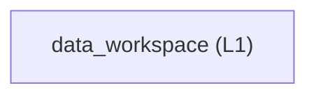

<!-- GENERATED BY govern-modular-event-architecture; DO NOT EDIT -->

# `data_workspace`

## Structure

## Modules

| ID | Level | Role | Parent | Implementation Status | Purpose |
|---|---|---|---|---|---|
| `data_workspace` | L1 | domain | `studio_application` | implemented | Own imported recordings, mappings, test conditions, cycles, annotations, and derived Normal regions. |

### `data_workspace`

- **Purpose:** Own imported recordings, mappings, test conditions, cycles, annotations, and derived Normal regions.
- **Parent:** `studio_application`
- **Implementation Status:** `implemented`
- **Input Ports:** `workspace.command`
- **Output Ports:** `workspace.tabular-input`, `workspace.events`
- **Emitted Events:** `workspace.changed`
- **Owned State:** None
- **Side Effects:** None
- **Errors:** None
- **Invariants:** Collision truth is determined only by waveform interval annotation.; Normal regions are derived and read-only.; After annotation confirmation, derived Normal regions exclude each Collision onset-through-150-ms inclusive response window, clipped at the containing Cycle, without changing the user's persisted Collision interval. Existing confirmation validation rejects Cycles that cross a true acquisition discontinuity; the derivation also defensively stops a response window at the first such discontinuity.; Every valid Cycle matches its reference template's non-negative Pick, Put, and Fork Collision count tuple; each class may be absent, but the total event count is at least one.; Use as Reference atomically confirms one valid source Cycle and its contained labels before activating a template for exactly one Robot Speed.; One manually confirmed destination Anchor Cycle deterministically generates remaining provisional Cycles from the reference cadence before event and Ignore projection.; Reference Ignore intervals retain their non-empty reasons, and every generated destination interval remains provisional until explicit confirmation.; Manual annotations take precedence over projected proposals and different Robot Speeds never share a template.; Every annotation interval has one non-empty session identity that is unique within its recording and survives confirmation-state replacement.; Reopening a project preserves every stored interval identity and allocates later manual interval identities without collision.; Ignore intervals carry a non-empty user reason.; Ignore/Collision overlap invalidates annotation confirmation and Learning; half-open adjacency and Ignore/Pick/Put overlap retain existing semantics.; Tabular input preserves measured rows and source bytes and linearly interpolates one through three missing samples on all six raw axes. The nearest nominal interval count determines missing count; four missing samples or repaired periods outside inclusive two-percent tolerance reject the recording.; Inserted samples carry index provenance and retain continuous FIR/detector state and ordinary activity-based eligibility. Annotation views show repair positions and counts without per-gap confirmation.; Internal and External IMU mappings pass selected source values through unchanged; acquisition-specific transforms remain outside the application.; Viewport waveform projection reads original mapped samples without mutation, uses shared contiguous half-open buckets for Internal and External IMUs, and emits a pixel-bounded immutable raw or Min/Max plus arithmetic-mean representation without changing annotation indexes.
- **Entrypoints:** [`WorkspaceService`](../../src/dual_imu_collision_studio/domain/data_workspace/service.py) (class)
- **Public Symbols:** [`WorkspaceCommandPort`](../../src/dual_imu_collision_studio/domain/data_workspace/contracts.py) (protocol) [`TabularInputPort`](../../src/dual_imu_collision_studio/domain/data_workspace/contracts.py) (protocol) [`WorkspaceEventPort`](../../src/dual_imu_collision_studio/domain/data_workspace/contracts.py) (protocol) [`WaveformViewportProjection`](../../src/dual_imu_collision_studio/domain/data_workspace/model.py) (class)

## Port Contracts

| ID | Owner | Direction | Kind | Timing | Description | Symbols |
|---|---|---|---|---|---|---|
| `workspace.command` | `data_workspace` | input | command | sync | Import, configure, annotate, or validate workspace data.: Semantic recording, mapping, condition, atomic reference activation, destination Anchor Cycle, cadence generation, and same-speed annotation projection commands. | `WorkspaceCommandPort` |
| `workspace.tabular-input` | `data_workspace` | output | dependency | sync | Read selected tabular data through a domain-owned contract.: Column names, row values, and source metadata. | `TabularInputPort` |
| `workspace.events` | `data_workspace` | output | event | sync | Publish a committed workspace snapshot.: Immutable semantic workspace snapshot. | `WorkspaceEventPort` |

## Event Contracts

| ID | Owner | Delivery | Emitted when | Purpose | Consumers |
|---|---|---|---|---|---|
| `workspace.changed` | `data_workspace` | at-most-once | Import, mapping, condition, cycle, or annotation validation has committed. | Report a committed semantic workspace change. | `studio_application` |

## Type Catalog

| ID | Owner | Declaration | Visibility | Semantic kind | Consumers | References |
|---|---|---|---|---|---|---|
| `workspace-snapshot` | `data_workspace` | `WorkspaceSnapshot` (class, `src/dual_imu_collision_studio/domain/data_workspace/model.py`) | cross-module | domain-value | `studio_application` | None |
| `header-proposal` | `data_workspace` | `HeaderProposal` (class, `src/dual_imu_collision_studio/domain/data_workspace/model.py`) | cross-module | domain-value | `studio_application`, `data_workspace`, `tabular_adapter` | None |
| `activity-kind` | `data_workspace` | `ActivityKind` (class, `src/dual_imu_collision_studio/domain/data_workspace/model.py`) | cross-module | domain-value | `studio_application`, `data_workspace` | None |
| `annotation-interval` | `data_workspace` | `AnnotationInterval` (class, `src/dual_imu_collision_studio/domain/data_workspace/model.py`) | cross-module | domain-value | `studio_application`, `data_workspace` | `activity-kind` |
| `annotation-template-event` | `data_workspace` | `AnnotationTemplateEvent` (class, `src/dual_imu_collision_studio/domain/data_workspace/model.py`) | cross-module | domain-value | `studio_application`, `data_workspace` | `activity-kind` |
| `annotation-template` | `data_workspace` | `AnnotationTemplate` (class, `src/dual_imu_collision_studio/domain/data_workspace/model.py`) | cross-module | domain-value | `studio_application`, `data_workspace` | `annotation-template-event` |
| `test-condition` | `data_workspace` | `TestCondition` (class, `src/dual_imu_collision_studio/domain/data_workspace/model.py`) | cross-module | domain-value | `studio_application`, `data_workspace` | `activity-kind` |
| `recording` | `data_workspace` | `Recording` (class, `src/dual_imu_collision_studio/domain/data_workspace/model.py`) | cross-module | domain-value | `studio_application`, `data_workspace` | `activity-kind` |
| `column-mapping` | `data_workspace` | `ColumnMapping` (class, `src/dual_imu_collision_studio/domain/data_workspace/model.py`) | cross-module | domain-value | `studio_application`, `data_workspace` | `activity-kind` |
| `imported-samples` | `data_workspace` | `ImportedSamples` (class, `src/dual_imu_collision_studio/domain/data_workspace/model.py`) | cross-module | domain-value | `studio_application`, `data_workspace`, `tabular_adapter` | None |
| `waveform-viewport-projection` | `data_workspace` | `WaveformViewportProjection` (class, `src/dual_imu_collision_studio/domain/data_workspace/model.py`) | cross-module | domain-value | `studio_application` | None |
| `workspace-service` | `data_workspace` | `WorkspaceService` (class, `src/dual_imu_collision_studio/domain/data_workspace/service.py`) | module-public | domain-value | `studio_application`, `data_workspace` | `activity-kind` |
| `workspace-command-port` | `data_workspace` | `WorkspaceCommandPort` (class, `src/dual_imu_collision_studio/domain/data_workspace/contracts.py`) | cross-module | port | `studio_application`, `data_workspace` | `activity-kind` |
| `tabular-input-port` | `data_workspace` | `TabularInputPort` (class, `src/dual_imu_collision_studio/domain/data_workspace/contracts.py`) | cross-module | port | `data_workspace`, `tabular_adapter` | `activity-kind` |
| `workspace-event-port` | `data_workspace` | `WorkspaceEventPort` (class, `src/dual_imu_collision_studio/domain/data_workspace/contracts.py`) | cross-module | port | `studio_application`, `data_workspace` | `activity-kind` |

## State Ownership

| ID | Owner | Declaration | Type | Visibility | Mutability | Read authority | Write authority |
|---|---|---|---|---|---|---|---|

## Cross-module Mapping

| Interaction | Producer | Consumer | Parent | Producer contract | Consumer contract | Mapping owner | State accessed | Allowed edges | Forbidden edges |
|---|---|---|---|---|---|---|---|---|---|

## End-to-End Flows

### `prepare-workspace`

Import recordings and produce a validated annotated workspace.

#### Flow Diagram

```mermaid
sequenceDiagram
    participant n_data_workspace as data_workspace
    participant n_studio_application as studio_application
    n_data_workspace->>n_data_workspace: Map QML drag coordinates to sample-index intervals, preserve session-local undo history, atomically confirm and activate a selected reference Cycle, generate provisional Cycles from one destination Anchor and the reference cadence, project provisional events and Ignore reasons only into equal-speed recordings, then validate mapping, samples, test conditions, cycles, Ignore reasons, and interval partition rules before committing truth. For annotation display, project the shared original-sample viewport through ALG-0008 into raw points or deterministic width-bounded Min/Max and arithmetic-mean buckets before L0 maps primitives to the desktop renderer.
    Note right of n_data_workspace: workspace.changed
    n_data_workspace->>+n_studio_application: After successful reference activation, clear both application-owned annotation selection representations before publishing refreshed UI state.
    n_studio_application-->>-n_data_workspace: step 2
```

#### Ordered Steps

| # | Module | Action | Receives | Emits | State changes | Side effects |
|---|---|---|---|---|---|---|
| 1 | `data_workspace` | Map QML drag coordinates to sample-index intervals, preserve session-local undo history, atomically confirm and activate a selected reference Cycle, generate provisional Cycles from one destination Anchor and the reference cadence, project provisional events and Ignore reasons only into equal-speed recordings, then validate mapping, samples, test conditions, cycles, Ignore reasons, and interval partition rules before committing truth. For annotation display, project the shared original-sample viewport through ALG-0008 into raw points or deterministic width-bounded Min/Max and arithmetic-mean buckets before L0 maps primitives to the desktop renderer. | `workspace.command`, `workspace.tabular-input` | `workspace.changed` | None | None |
| 2 | `studio_application` | After successful reference activation, clear both application-owned annotation selection representations before publishing refreshed UI state. | `workspace.changed` | None | None | None |

- **Success:** A complete immutable workspace snapshot is available.

#### Execution efficiency

- Workload `interactive-workspace`: `best-effort`; steps `prepare-workspace.step-1`, `prepare-workspace.step-2`; profiles [`windows-desktop`](execution-windows-desktop.md).
