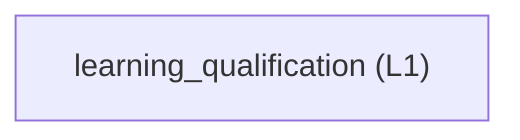

<!-- GENERATED BY govern-modular-event-architecture; DO NOT EDIT -->

# `learning_qualification`

## Structure



## Modules

| ID | Level | Role | Parent | Implementation Status | Purpose |
|---|---|---|---|---|---|
| `learning_qualification` | L1 | domain | `studio_application` | implemented | Fit independently selected FIR and custom-depth MLP candidates, retain original fold kernels and replay exact frozen predictions across supplied conditions. |

### `learning_qualification`

- **Purpose:** Fit independently selected FIR and custom-depth MLP candidates, retain original fold kernels and replay exact frozen predictions across supplied conditions.
- **Parent:** `studio_application`
- **Implementation Status:** `implemented`
- **Input Ports:** `learning.command`, `learning.replay-export`, `learning.model-export`
- **Output Ports:** `learning.events`, `learning.history-execution`, `learning.execution`, `learning.replay-file-output`, `learning.model-file-output`
- **Emitted Events:** `learning.progressed`, `learning.completed`, `learning.cancelled`
- **Owned State:** None
- **Side Effects:** None
- **Errors:** None
- **Invariants:** Qualification always replays all supplied speeds.; Qualification always replays all supplied offsets, including offsets excluded from subsequent fitting rounds.; Every supplied speed and offset tuple retains exact activity denominators, false-trigger counts, collision detections, latency, and status provenance.; Every completed per-recording Qualification result retains all Collision Detector Score SNR values in chronological order. Signal is the finite Score peak in the existing inclusive 150-ms response window; shared noise is finite Score RMS outside annotated Collision and Ignore intervals. Invalid positive finite ratios remain unavailable and never change Qualification decisions.; SPEC-0011 uses configurable two-to-ten complete-Cycle folds, default three. Each recording has at least two valid Cycles; each condition has at least N. Every fold retains Training from every recording and Validation from every condition with per-condition counts differing by at most one. Counts/allocation failure stops the run; no automatic N reduction.; Each Start captures new settings and seed; each round captures a balanced fold map reused by every parameter candidate. Common Training and Validation targets support 128 ms History and exclude Collision and Ignore. Missing common targets skip the round without resampling or lowering History.; Candidate Loss is the maximum across conditions of the equal-fold average of Validation MSE, or the default half Training plus half Validation MSE. Target-cast original fold models supply prediction and subtraction before float64 squaring. Residual STD uses only final fitting rows.; Search jointly optimizes tap depth through 128 ms and continuous Ridge alpha from 1e-6 to 100; integer K from 2 to 32 is active only with optional Robust refit, default off. Coarse top two plus raw ties seed fine search. Neighbors project to bounds before deduplication; final steps are one tap, one K, and alpha factor 1.05 with configured relative improvement tolerance. All paths complete; each effective parameter/fold runs once per context.; Fixed-grid mode accepts only checked 4/8/16/32/64/128 ms History aliases and checked 1e-6/1e-4/0.01/1/100 Ridge alphas, deduplicates equal effective taps while preserving aliases, fixes Robust K to zero, and performs no coarse or fine search. Its effective Cartesian-product points reuse the same grouped N-fold Loss ranking, Validation allowance, fold-kernel selection, Qualification and fallback path as optimized mode; evaluated nonwinning points remain visible as CV-rejected evidence.; All valid parameters within the configured relative convergence tolerance of the minimum raw Parameter Loss are retained. Per-condition raw Validation allowance filters their original fold kernels, then each parameter retains every fold whose raw maximum-condition Kernel Loss exactly equals that parameter's raw minimum; rounded and second-place near ties are excluded. Every admitted parameter and fold completes Qualification before ranking. No final all-data refit or worse-parameter rescue occurs.; A passing collision detection has latency no greater than 150 ms from the confirmed collision interval start, inclusive, regardless of interval end.; A recording passes when at least one Collision interval exists, every Collision is detected within the inclusive 150 ms onset deadline, and every present Normal, Pick, or Put interval has zero false triggers. A missing Normal, Pick, or Put class is neutral; missing Collision evidence is COVERAGE_GAP.; A retained fallback is accepted only when its training range equals its qualified range.; Each outer round trains all remaining offsets and exhausts lowest-speed removal until the active range passes or only one speed remains. Success or exhaustion then excludes the smallest active offset and restores all supplied speeds.; Only full active-range matches enter the qualified pool. Ranking prefers more supplied speed strata, more active offsets, shorter taps, lower worst latency, larger robustness margin, then stable parameter order (SPEC-0008; ALG-0004).; Proven insufficient Training evidence skips only that round, preserves earlier retained winners, and continues suffix/offset progression. Unavailable scopes and reasons remain in progress and completed results; unclassified empty models and input/resource/unexpected execution failures are not missing evidence. Narrowly classified candidate numerical failures invalidate that full-N parameter configuration with parameter and fold diagnostics; they never fabricate Loss.; SPEC-0009 derives per-model N as the maximum of active-round Normal interval maxima and C as the minimum of active-round per-Collision window maxima. Collision uses its inclusive onset-through-150-ms window excluding Ignore. Search starts at N with step 0.5 and includes C, omits zero and duplicate target values, and never expands the bounds. Qualification still requires every labeled Collision to be detected.; Qualification, Replay, and exported Profile semantics use the strict detector predicate Score greater than Threshold; equality does not fill confirmation history. Release and re-arm remain strictly below release_ratio times Threshold.; Collision response evidence is the fixed onset-through-150-ms window minus Ignore samples. Preserve timestamps and retain eligible samples after Ignore; do not extend or shorten the absolute deadline, compress time, or reset detector state. Actual Collision annotations still cannot overlap Ignore.; Derived Normal evidence and Collision acceptance evidence use the same onset-through-150-ms boundary, so one sample cannot belong to both classes for the same Collision.; Missing whole-round bound evidence skips that round; C below N or no positive candidates skips that model with bounds and reason. Existing fallback and earlier qualified results are retained. Numerical failures are never evidence shortages.; For one fixed History, frozen model, target numeric type, Score Mode, and recording, normalized detector scores are computed once and reused across Threshold and Confirmation candidates without crossing the frozen-fold-kernel lifetime.; Diagnostic ranking compares retained selected fold-kernel results over every supplied recording by total false trigger events plus missed collision intervals, then finite worst collision latency, retaining all exact ties.; Diagnostic-only winners are never exportable Profiles.; Replay CSV serialization preserves full-resolution sample alignment and emits the exact governed diagnostic header order without substituting display-only zeroes.; Training uses only Cycle-contained Normal Robot Motion, Robot Pick, and Robot Put samples; Collision, Ignore, and Cycle-external samples are excluded and split FIR history.; Replay prediction and detector arithmetic start at the first sample with unavailable Internal FIR history initialized to zero. Numeric startup scores participate normally; successfully interpolated gaps preserve FIR and detector continuity.; Ignore never resets or pauses detector state; Ignore evidence remains visible but is excluded from Training and qualification pass or fail counts only.; Qualification counts false triggers in every non-Ignore Normal, Pick, Put, and Cycle-external sample; Cycle-external events aggregate into normal_false_events for compatibility.; Model TXT serialization emits deterministic scalar metadata, FIR weights, bias, residual center, and residual scale without changing stored project or profile schemas.; Search and fold-selection progress publishes typed Loss evidence; every retained candidate preserves the exact ordered per-recording Qualification metrics used by its condition aggregates.; Cancellation retains only candidates whose complete Qualification evidence committed before cancellation observation. Completed qualified candidates remain selectable; only when none qualifies does the existing minimum-total-error, finite-latency, exact-tie diagnostic ranking become visible. The terminal state remains Cancelled.; FIR and MLP sample and select independently; model-family results retain separate seeds, fold maps and immutable kernels.; MLP hidden depth is a custom positive integer defaulting to two; each layer independently selects widths 4,8,16,32,64,128. Only selected Cartesian combinations run; no final all-data refit.; SPEC-0030 adds one-sensor Ridge self-prediction using only lags 1..L, adopted causal SOS preprocessing, explicit warmup, continuous Ignore history and separate frozen model identity.
- **Entrypoints:** [`LearningService`](../../src/dual_imu_collision_studio/domain/learning/service.py) (class)
- **Public Symbols:** [`LearningCommandPort`](../../src/dual_imu_collision_studio/domain/learning/contracts.py) (protocol)<br>[`LearningEventPort`](../../src/dual_imu_collision_studio/domain/learning/contracts.py) (protocol)<br>[`HistoryExecutionPort`](../../src/dual_imu_collision_studio/domain/learning/contracts.py) (protocol)<br>[`ReplayCsvFilePort`](../../src/dual_imu_collision_studio/domain/learning/contracts.py) (protocol)<br>[`ModelTextFilePort`](../../src/dual_imu_collision_studio/domain/learning/contracts.py) (protocol)<br>[`LearningService`](../../src/dual_imu_collision_studio/domain/learning/service.py) (class)<br>[`LearningExecutionPort`](../../src/dual_imu_collision_studio/domain/learning/contracts.py) (class)<br>[`service_for_dataset`](../../src/dual_imu_collision_studio/domain/learning/self_imu.py) (function)

## Port Contracts

| ID | Owner | Direction | Kind | Timing | Description | Symbols |
|---|---|---|---|---|---|---|
| `learning.command` | `learning_qualification` | input | command | async | Start or cancel one bounded learning and qualification run.: Workspace snapshot, numeric type, captured Training mode, mode-specific candidate policy, grouped-CV settings, and memory limit. | `LearningCommandPort` |
| `learning.events` | `learning_qualification` | output | event | async | Publish learning progress and committed qualification results.: Progress stage, candidate counts, typed parameter and kernel Loss evidence, speed coverage, per-recording Qualification results, qualified ranking, minimum-misjudgment diagnostic ranking, selected profile, and an immutable completed-candidate snapshot when cancellation terminates accepted work. | `LearningEventPort` |
| `learning.history-execution` | `learning_qualification` | output | dependency | async | Execute the four independent requested-History jobs for one fallback round without exposing process technology to Learning.: Immutable History jobs, ordered results, bounded progress, typed failures, attempt durations, and process-tree Peak RSS evidence. | `HistoryExecutionPort` |
| `learning.replay-export` | `learning_qualification` | input | command | async | Render one selected candidate and complete recording as the governed full-resolution diagnostic CSV schema.: Immutable ReplayEvidence containing aligned raw, FIR, residual, detector score, threshold, ratio, state, and trigger values. | `LearningService` |
| `learning.replay-file-output` | `learning_qualification` | output | dependency | sync | Atomically replace one user-selected Replay CSV destination without exposing filesystem technology to Learning.: Destination path and a deterministic stream of UTF-8 CSV rows rendered from one immutable ReplayEvidence value. | `ReplayCsvFilePort` |
| `learning.model-export` | `learning_qualification` | input | command | async | Render one selected retained candidate as the governed deterministic Model TXT schema.: Candidate identifier, sample rate, numeric type, detector parameters, FIR weights, bias, residual center, and residual scale. | `LearningService` |
| `learning.model-file-output` | `learning_qualification` | output | dependency | sync | Atomically replace one user-selected Model TXT destination without exposing filesystem technology to Learning.: Destination path and a deterministic stream of UTF-8 LF-delimited Model TXT lines. | `ModelTextFilePort` |
| `learning.execution` | `learning_qualification` | output | query | sync | Execute complete candidate-fold or recording jobs under one globally bounded queue.: Immutable dataset and fold jobs or independent complete recording jobs; ordered results and resource evidence. | `LearningExecutionPort` |

## Event Contracts

| ID | Owner | Delivery | Emitted when | Purpose | Consumers |
|---|---|---|---|---|---|
| `learning.progressed` | `learning_qualification` | at-most-once | A progress interval or learning stage boundary is reached. | Report bounded progress without exposing mutable worker state. | `studio_application`, `desktop_adapter` |
| `learning.completed` | `learning_qualification` | at-most-once | Exact typed replay and fallback evaluation have completed. | Report deterministic qualification and ranking results. | `studio_application`, `desktop_adapter` |
| `learning.cancelled` | `learning_qualification` | at-most-once | Accepted Learning work observes cancellation after atomically freezing its current partial QualificationResult. | Report user cancellation together with the last committed complete-candidate result. | `studio_application`, `desktop_adapter` |

## Type Catalog

| ID | Owner | Declaration | Visibility | Semantic kind | Consumers | References |
|---|---|---|---|---|---|---|
| `learning-request` | `learning_qualification` | `LearningRequest` (class, `src/dual_imu_collision_studio/domain/learning/model.py`) | cross-module | command | `studio_application`, `learning_qualification` | `learning-settings` |
| `qualification-result` | `learning_qualification` | `QualificationResult` (class, `src/dual_imu_collision_studio/domain/learning/model.py`) | cross-module | domain-value | `studio_application` | `qualified-candidate`, `learning-progress` |
| `learning-cancelled` | `learning_qualification` | `LearningCancelled` (class, `src/dual_imu_collision_studio/domain/learning/model.py`) | cross-module | domain-value | `learning_qualification`, `studio_application` | `qualification-result` |
| `history-spec` | `learning_qualification` | `HistorySpec` (class, `src/dual_imu_collision_studio/domain/learning/model.py`) | cross-module | domain-value | `studio_application`, `learning_qualification` | `single-imu-settings` |
| `candidate-plan` | `learning_qualification` | `CandidatePlan` (class, `src/dual_imu_collision_studio/domain/learning/model.py`) | cross-module | domain-value | `studio_application`, `learning_qualification` | `single-imu-settings` |
| `history-job` | `learning_qualification` | `HistoryJob` (class, `src/dual_imu_collision_studio/domain/learning/model.py`) | cross-module | domain-value | `learning_qualification`, `history_worker_adapter` | `single-imu-settings` |
| `history-execution-error` | `learning_qualification` | `HistoryExecutionError` (class, `src/dual_imu_collision_studio/domain/learning/model.py`) | cross-module | domain-value | `studio_application`, `learning_qualification`, `history_worker_adapter` | `single-imu-settings` |
| `hardware-memory-insufficient-error` | `learning_qualification` | `HardwareMemoryInsufficientError` (class, `src/dual_imu_collision_studio/domain/learning/model.py`) | cross-module | domain-value | `studio_application`, `learning_qualification`, `history_worker_adapter` | `history-execution-error` |
| `insufficient-training-evidence` | `learning_qualification` | `InsufficientTrainingEvidence` (class, `src/dual_imu_collision_studio/domain/learning/model.py`) | module-public | domain-value | `learning_qualification` | `single-imu-settings` |
| `history-job-result` | `learning_qualification` | `HistoryJobResult` (class, `src/dual_imu_collision_studio/domain/learning/model.py`) | cross-module | domain-value | `learning_qualification`, `history_worker_adapter` | `single-imu-settings` |
| `history-batch-result` | `learning_qualification` | `HistoryBatchResult` (class, `src/dual_imu_collision_studio/domain/learning/model.py`) | cross-module | domain-value | `learning_qualification`, `history_worker_adapter` | `single-imu-settings` |
| `history-attempt-timing` | `learning_qualification` | `HistoryAttemptTiming` (class, `src/dual_imu_collision_studio/domain/learning/model.py`) | cross-module | domain-value | `studio_application`, `learning_qualification`, `history_worker_adapter` | `single-imu-settings` |
| `history-worker-progress` | `learning_qualification` | `HistoryWorkerProgress` (class, `src/dual_imu_collision_studio/domain/learning/model.py`) | cross-module | domain-value | `studio_application`, `learning_qualification`, `history_worker_adapter` | `single-imu-settings` |
| `fir-matrix-evidence` | `learning_qualification` | `FirMatrixEvidence` (class, `src/dual_imu_collision_studio/domain/learning/model.py`) | private | domain-value | `learning_qualification` | `single-imu-settings` |
| `history-fold-evidence` | `learning_qualification` | `HistoryFoldEvidence` (class, `src/dual_imu_collision_studio/domain/learning/model.py`) | private | domain-value | `learning_qualification` | `single-imu-settings` |
| `learning-log-evidence` | `learning_qualification` | `LearningLogEvidence` (class, `src/dual_imu_collision_studio/domain/learning/model.py`) | cross-module | domain-value | `learning_qualification`, `studio_application` | `parameter-point` |
| `learning-progress` | `learning_qualification` | `LearningProgress` (class, `src/dual_imu_collision_studio/domain/learning/model.py`) | cross-module | domain-value | `studio_application`, `learning_qualification` | `learning-log-evidence` |
| `learning-interval` | `learning_qualification` | `LearningInterval` (class, `src/dual_imu_collision_studio/domain/learning/model.py`) | cross-module | domain-value | `studio_application`, `learning_qualification` | `single-imu-settings` |
| `learning-recording` | `learning_qualification` | `LearningRecording` (class, `src/dual_imu_collision_studio/domain/learning/model.py`) | cross-module | domain-value | `studio_application`, `learning_qualification` | `single-imu-settings` |
| `learning-dataset` | `learning_qualification` | `LearningDataset` (class, `src/dual_imu_collision_studio/domain/learning/model.py`) | cross-module | domain-value | `studio_application`, `learning_qualification` | `single-imu-settings` |
| `fit-evidence` | `learning_qualification` | `FitEvidence` (class, `src/dual_imu_collision_studio/domain/learning/model.py`) | cross-module | domain-value | `studio_application`, `learning_qualification` | `single-imu-settings` |
| `cycle-fold-group` | `learning_qualification` | `CycleFoldGroup` (class, `src/dual_imu_collision_studio/domain/learning/model.py`) | cross-module | domain-value | `studio_application`, `learning_qualification` | `single-imu-settings` |
| `cross-validation-fold` | `learning_qualification` | `CrossValidationFold` (class, `src/dual_imu_collision_studio/domain/learning/model.py`) | cross-module | domain-value | `studio_application`, `learning_qualification` | `single-imu-settings` |
| `cross-validation-plan` | `learning_qualification` | `CrossValidationPlan` (class, `src/dual_imu_collision_studio/domain/learning/model.py`) | cross-module | domain-value | `studio_application`, `learning_qualification` | `single-imu-settings` |
| `cross-validated-model` | `learning_qualification` | `CrossValidatedModel` (class, `src/dual_imu_collision_studio/domain/learning/model.py`) | cross-module | domain-value | `studio_application`, `learning_qualification` | `single-imu-settings` |
| `detector-config` | `learning_qualification` | `DetectorConfig` (class, `src/dual_imu_collision_studio/domain/learning/model.py`) | cross-module | domain-value | `studio_application`, `learning_qualification` | `single-imu-settings` |
| `detector-trace` | `learning_qualification` | `DetectorTrace` (class, `src/dual_imu_collision_studio/domain/learning/model.py`) | cross-module | domain-value | `studio_application`, `learning_qualification` | `single-imu-settings` |
| `replay-evidence` | `learning_qualification` | `ReplayEvidence` (class, `src/dual_imu_collision_studio/domain/learning/model.py`) | cross-module | domain-value | `studio_application`, `learning_qualification` | `detector-trace`, `qualified-candidate`, `learning-recording` |
| `recording-qualification` | `learning_qualification` | `RecordingQualification` (class, `src/dual_imu_collision_studio/domain/learning/model.py`) | cross-module | domain-value | `learning_qualification`, `studio_application` | None |
| `qualified-candidate` | `learning_qualification` | `QualifiedCandidate` (class, `src/dual_imu_collision_studio/domain/learning/model.py`) | cross-module | domain-value | `studio_application`, `learning_qualification` | `recording-qualification` |
| `condition-qualification` | `learning_qualification` | `ConditionQualification` (class, `src/dual_imu_collision_studio/domain/learning/model.py`) | cross-module | domain-value | `studio_application`, `learning_qualification` | `single-imu-settings` |
| `offset-qualification` | `learning_qualification` | `OffsetQualification` (class, `src/dual_imu_collision_studio/domain/learning/model.py`) | cross-module | domain-value | `studio_application`, `learning_qualification` | `single-imu-settings` |
| `fallback-state` | `learning_qualification` | `FallbackState` (class, `src/dual_imu_collision_studio/domain/learning/model.py`) | cross-module | domain-value | `studio_application`, `learning_qualification` | `single-imu-settings` |
| `fallback-action` | `learning_qualification` | `FallbackAction` (class, `src/dual_imu_collision_studio/domain/learning/model.py`) | cross-module | domain-value | `studio_application`, `learning_qualification` | `single-imu-settings` |
| `fallback-transition` | `learning_qualification` | `FallbackTransition` (class, `src/dual_imu_collision_studio/domain/learning/model.py`) | cross-module | domain-value | `studio_application`, `learning_qualification` | `single-imu-settings` |
| `frozen-fir-model` | `learning_qualification` | `FrozenFirModel` (class, `src/dual_imu_collision_studio/domain/learning/model.py`) | cross-module | domain-value | `studio_application`, `learning_qualification` | `single-imu-settings` |
| `learning-service` | `learning_qualification` | `LearningService` (class, `src/dual_imu_collision_studio/domain/learning/service.py`) | module-public | domain-value | `studio_application`, `learning_qualification` | `single-imu-settings` |
| `learning-command-port` | `learning_qualification` | `LearningCommandPort` (class, `src/dual_imu_collision_studio/domain/learning/contracts.py`) | cross-module | port | `studio_application`, `learning_qualification` | `single-imu-settings` |
| `learning-event-port` | `learning_qualification` | `LearningEventPort` (class, `src/dual_imu_collision_studio/domain/learning/contracts.py`) | cross-module | port | `studio_application`, `learning_qualification` | `single-imu-settings` |
| `history-execution-port` | `learning_qualification` | `HistoryExecutionPort` (class, `src/dual_imu_collision_studio/domain/learning/contracts.py`) | cross-module | port | `learning_qualification`, `history_worker_adapter` | `single-imu-settings` |
| `replay-csv-file-port` | `learning_qualification` | `ReplayCsvFilePort` (class, `src/dual_imu_collision_studio/domain/learning/contracts.py`) | cross-module | port | `learning_qualification`, `studio_application`, `desktop_adapter` | `single-imu-settings` |
| `model-text-file-port` | `learning_qualification` | `ModelTextFilePort` (class, `src/dual_imu_collision_studio/domain/learning/contracts.py`) | cross-module | port | `learning_qualification`, `studio_application`, `desktop_adapter` | `single-imu-settings` |
| `training-mode` | `learning_qualification` | `TrainingMode` (enum, `src/dual_imu_collision_studio/domain/learning/model.py`) | cross-module | domain-value | `learning_qualification`, `studio_application`, `history_worker_adapter` | None |
| `learning-settings` | `learning_qualification` | `LearningSettings` (class, `src/dual_imu_collision_studio/domain/learning/model.py`) | cross-module | domain-value | `learning_qualification`, `studio_application`, `history_worker_adapter` | `training-mode` |
| `parameter-point` | `learning_qualification` | `ParameterPoint` (class, `src/dual_imu_collision_studio/domain/learning/model.py`) | cross-module | domain-value | `learning_qualification`, `studio_application`, `history_worker_adapter` | None |
| `condition-loss` | `learning_qualification` | `ConditionLoss` (class, `src/dual_imu_collision_studio/domain/learning/model.py`) | cross-module | domain-value | `learning_qualification`, `studio_application`, `history_worker_adapter` | None |
| `fold-job` | `learning_qualification` | `FoldJob` (class, `src/dual_imu_collision_studio/domain/learning/model.py`) | cross-module | domain-value | `learning_qualification`, `studio_application`, `history_worker_adapter` | `parameter-point`, `learning-settings`, `cycle-fold-group` |
| `fold-result` | `learning_qualification` | `FoldResult` (class, `src/dual_imu_collision_studio/domain/learning/model.py`) | cross-module | domain-value | `learning_qualification`, `studio_application`, `history_worker_adapter` | `parameter-point`, `condition-loss`, `frozen-fir-model` |
| `parameter-result` | `learning_qualification` | `ParameterResult` (class, `src/dual_imu_collision_studio/domain/learning/model.py`) | cross-module | domain-value | `learning_qualification`, `studio_application`, `history_worker_adapter` | `parameter-point`, `fold-result` |
| `kernel-training-evidence` | `learning_qualification` | `KernelTrainingEvidence` (class, `src/dual_imu_collision_studio/domain/learning/model.py`) | cross-module | domain-value | `learning_qualification`, `studio_application`, `history_worker_adapter` | `learning-settings`, `condition-loss`, `cross-validation-plan` |
| `round-provenance` | `learning_qualification` | `RoundProvenance` (class, `src/dual_imu_collision_studio/domain/learning/model.py`) | cross-module | domain-value | `learning_qualification`, `studio_application`, `history_worker_adapter` | `cross-validation-plan` |
| `run-provenance` | `learning_qualification` | `RunProvenance` (class, `src/dual_imu_collision_studio/domain/learning/model.py`) | cross-module | domain-value | `learning_qualification`, `studio_application`, `history_worker_adapter` | `learning-settings`, `round-provenance` |
| `fold-memory-estimate` | `learning_qualification` | `FoldMemoryEstimate` (class, `src/dual_imu_collision_studio/domain/learning/memory.py`) | cross-module | domain-value | `learning_qualification`, `history_worker_adapter` | None |
| `evidence-row-counts` | `learning_qualification` | `EvidenceRowCounts` (class, `src/dual_imu_collision_studio/domain/learning/memory.py`) | private | domain-value | `learning_qualification` | None |
| `execution-batch` | `learning_qualification` | `ExecutionBatch` (class, `src/dual_imu_collision_studio/domain/learning/model.py`) | cross-module | domain-value | `learning_qualification`, `studio_application`, `history_worker_adapter` | `fold-result` |
| `recording-job` | `learning_qualification` | `RecordingJob` (class, `src/dual_imu_collision_studio/domain/learning/model.py`) | cross-module | domain-value | `learning_qualification`, `studio_application`, `history_worker_adapter` | `learning-recording`, `frozen-fir-model`, `detector-config` |
| `recording-result` | `learning_qualification` | `RecordingResult` (class, `src/dual_imu_collision_studio/domain/learning/model.py`) | cross-module | domain-value | `learning_qualification`, `studio_application`, `history_worker_adapter` | None |
| `candidate-numerical-error` | `learning_qualification` | `CandidateNumericalError` (class, `src/dual_imu_collision_studio/domain/learning/model.py`) | cross-module | domain-value | `learning_qualification`, `studio_application`, `history_worker_adapter` | None |
| `cycle-allocation-error` | `learning_qualification` | `CycleAllocationError` (class, `src/dual_imu_collision_studio/domain/learning/model.py`) | cross-module | domain-value | `learning_qualification`, `studio_application`, `history_worker_adapter` | None |
| `learning-execution-port` | `learning_qualification` | `LearningExecutionPort` (class, `src/dual_imu_collision_studio/domain/learning/contracts.py`) | cross-module | port | `learning_qualification`, `history_worker_adapter` | `fold-job`, `recording-job`, `execution-batch` |
| `frozen-mlp-model` | `learning_qualification` | `FrozenMlpModel` (class, `src/dual_imu_collision_studio/domain/learning/model.py`) | cross-module | domain-value | `studio_application`, `learning_qualification` | None |
| `filter-stage-spec` | `learning_qualification` | `FilterStageSpec` (class, `src/dual_imu_collision_studio/domain/learning/preprocessing.py`) | cross-module | domain-value | `learning_qualification`, `studio_application`, `history_worker_adapter` | None |
| `filter-design` | `learning_qualification` | `FilterDesign` (class, `src/dual_imu_collision_studio/domain/learning/preprocessing.py`) | cross-module | domain-value | `learning_qualification`, `studio_application`, `history_worker_adapter` | `filter-stage-spec` |
| `single-imu-settings` | `learning_qualification` | `SingleImuSettings` (class, `src/dual_imu_collision_studio/domain/learning/preprocessing.py`) | cross-module | domain-value | `learning_qualification`, `studio_application`, `history_worker_adapter` | `filter-design` |
| `frozen-self-imu-model` | `learning_qualification` | `FrozenSelfImuModel` (class, `src/dual_imu_collision_studio/domain/learning/self_imu.py`) | cross-module | domain-value | `learning_qualification`, `studio_application`, `history_worker_adapter` | `frozen-fir-model`, `single-imu-settings` |
| `self-imu-learning-service` | `learning_qualification` | `SelfImuLearningService` (class, `src/dual_imu_collision_studio/domain/learning/self_imu.py`) | module-public | domain-value | `learning_qualification`, `studio_application`, `history_worker_adapter` | `learning-service` |

## State Ownership

| ID | Owner | Declaration | Type | Visibility | Mutability | Read authority | Write authority |
|---|---|---|---|---|---|---|---|

## Cross-module Mapping

| Interaction | Producer | Consumer | Parent | Producer contract | Consumer contract | Mapping owner | State accessed | Allowed edges | Forbidden edges |
|---|---|---|---|---|---|---|---|---|---|

## End-to-End Flows

### `learn-and-qualify`

Fit candidate kernels and qualify exact target replay across all supplied offsets and speeds using nested fallback rounds.

#### Flow Diagram

```mermaid
sequenceDiagram
    participant n_learning_qualification as learning_qualification
    participant n_history_worker_adapter as history_worker_adapter
    n_learning_qualification->>n_learning_qualification: Capture settings and run seed, preflight complete-Cycle counts, and allocate a fresh reproducible round fold map. Check common 128-ms evaluation and threshold evidence. In fixed-grid mode dispatch only the deduplicated checked History by alpha Cartesian product with Robust K zero and publish every evaluated disposition; in optimized mode dispatch the unchanged coarse and joint fine frontiers. Require all N results before shared aggregation and publish typed Loss evidence plus the rounded round-final Loss.
    Note right of n_learning_qualification: learning.progressed
    n_learning_qualification->>+n_history_worker_adapter: Reuse up to eight spawn processes for candidate-fold fitting and up to four for whole-recording Score or detector replay. No nested pools, retries, time slicing, adaptive worker reduction or worker-local model selection. Return immutable job-identified results and aggregate Peak RSS evidence; memory, cancellation or unexpected failure terminates the batch.
    n_history_worker_adapter-->>-n_learning_qualification: step 2
    n_history_worker_adapter->>+n_learning_qualification: Aggregate equal-fold condition losses, retain every parameter within the configured relative tolerance of the minimum raw Parameter Loss, apply Validation allowance, and retain every fold whose raw maximum-condition Kernel Loss exactly equals that parameter's raw minimum while excluding rounded and second-place near ties. Publish the current parameter and fold plus completed, remaining, and derived total Qualification work. Qualify every admitted original kernel without refit before ranking, using the maximum Normal interval maximum as N, the minimum of the per-Collision window maxima as C for candidate generation, the strict Score-greater-than-Threshold predicate, mandatory all-Collision detection within the inclusive 150-ms minus-Ignore deadline, and neutral absence of Normal, Pick, or Put classes. Derive chronological per-Collision Detector Score SNR from each existing whole-recording Score trace without changing detector decisions. Commit every fully qualified selected kernel immediately with its ordered per-recording metrics and provenance. On normal completion publish the fallback result; on cancellation publish only the committed qualified candidates or, when none qualifies, the existing minimum-total-error diagnostic subset while keeping the terminal state Cancelled. See ALG-0007, ALG-0006, ALG-0005, ALG-0004 and ALG-0003.
    Note right of n_learning_qualification: learning.progressed, learning.completed, learning.cancelled
    n_learning_qualification-->>-n_history_worker_adapter: step 3
```

#### Ordered Steps

| # | Module | Action | Receives | Emits | State changes | Side effects |
|---|---|---|---|---|---|---|
| 1 | `learning_qualification` | Capture settings and run seed, preflight complete-Cycle counts, and allocate a fresh reproducible round fold map. Check common 128-ms evaluation and threshold evidence. In fixed-grid mode dispatch only the deduplicated checked History by alpha Cartesian product with Robust K zero and publish every evaluated disposition; in optimized mode dispatch the unchanged coarse and joint fine frontiers. Require all N results before shared aggregation and publish typed Loss evidence plus the rounded round-final Loss. | `learning.command`, `learning.history-execution` | `learning.progressed` | None | None |
| 2 | `history_worker_adapter` | Reuse up to eight spawn processes for candidate-fold fitting and up to four for whole-recording Score or detector replay. No nested pools, retries, time slicing, adaptive worker reduction or worker-local model selection. Return immutable job-identified results and aggregate Peak RSS evidence; memory, cancellation or unexpected failure terminates the batch. | `learning.history-execution` | None | None | Spawn, monitor, retry, join, or terminate child processes. |
| 3 | `learning_qualification` | Aggregate equal-fold condition losses, retain every parameter within the configured relative tolerance of the minimum raw Parameter Loss, apply Validation allowance, and retain every fold whose raw maximum-condition Kernel Loss exactly equals that parameter's raw minimum while excluding rounded and second-place near ties. Publish the current parameter and fold plus completed, remaining, and derived total Qualification work. Qualify every admitted original kernel without refit before ranking, using the maximum Normal interval maximum as N, the minimum of the per-Collision window maxima as C for candidate generation, the strict Score-greater-than-Threshold predicate, mandatory all-Collision detection within the inclusive 150-ms minus-Ignore deadline, and neutral absence of Normal, Pick, or Put classes. Derive chronological per-Collision Detector Score SNR from each existing whole-recording Score trace without changing detector decisions. Commit every fully qualified selected kernel immediately with its ordered per-recording metrics and provenance. On normal completion publish the fallback result; on cancellation publish only the committed qualified candidates or, when none qualifies, the existing minimum-total-error diagnostic subset while keeping the terminal state Cancelled. See ALG-0007, ALG-0006, ALG-0005, ALG-0004 and ALG-0003. | `learning.history-execution` | `learning.progressed`, `learning.completed`, `learning.cancelled` | None | None |

- **Success:** Retained round winners expose covered offsets, valid speed ranges, minimum-misjudgment diagnostic status, and full-resolution selectable Replay evidence; only qualified winners remain exportable.
- **Errors:** The user cancels accepted Learning work. → `learning.cancelled` → Discard incomplete candidate work, freeze the last complete-candidate result, expose qualified candidates or the diagnostic fallback in Replay, and retain the Cancelled terminal state.

#### Execution efficiency

- Workload `analysis-run`: `best-effort`; steps `learn-and-qualify.step-1`, `learn-and-qualify.step-2`, `learn-and-qualify.step-3`; profiles [`windows-desktop`](execution-windows-desktop.md).
