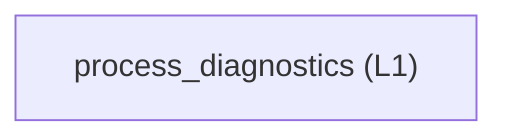

<!-- GENERATED BY govern-modular-event-architecture; DO NOT EDIT -->

# `process_diagnostics`

## Structure

## Modules

| ID | Level | Role | Parent | Implementation Status | Purpose |
|---|---|---|---|---|---|
| `process_diagnostics` | L1 | domain | `studio_application` | implemented | Define privacy-bounded process and Learning diagnostic records independently of persistence technology. |

### `process_diagnostics`

- **Purpose:** Define privacy-bounded process and Learning diagnostic records independently of persistence technology.
- **Parent:** `studio_application`
- **Implementation Status:** `implemented`
- **Input Ports:** None
- **Output Ports:** `diagnostics.output`
- **Emitted Events:** None
- **Owned State:** None
- **Side Effects:** None
- **Errors:** None
- **Invariants:** Diagnostic contracts never contain waveform rows, annotations, or model coefficients.
- **Entrypoints:** [`DiagnosticsPort`](../../src/dual_imu_collision_studio/domain/process_diagnostics/contracts.py) (protocol)
- **Public Symbols:** [`DiagnosticsPort`](../../src/dual_imu_collision_studio/domain/process_diagnostics/contracts.py) (protocol) [`DiagnosticStatus`](../../src/dual_imu_collision_studio/domain/process_diagnostics/model.py) (class) [`NullDiagnostics`](../../src/dual_imu_collision_studio/domain/process_diagnostics/contracts.py) (class)

## Port Contracts

| ID | Owner | Direction | Kind | Timing | Description | Symbols |
|---|---|---|---|---|---|---|
| `diagnostics.output` | `process_diagnostics` | output | dependency | sync | Persist bounded process-lifecycle, Learning-stage, and Qt/QML diagnostic evidence.: Immutable diagnostic status plus primitive stage, progress, Speed, Offset, failure, and runtime metadata without dataset payloads. | `DiagnosticsPort` |

## Event Contracts

| ID | Owner | Delivery | Emitted when | Purpose | Consumers |
|---|---|---|---|---|---|

## Type Catalog

| ID | Owner | Declaration | Visibility | Semantic kind | Consumers | References |
|---|---|---|---|---|---|---|
| `diagnostic-status` | `process_diagnostics` | `DiagnosticStatus` (class, `src/dual_imu_collision_studio/domain/process_diagnostics/model.py`) | cross-module | domain-value | `process_diagnostics`, `studio_application`, `desktop_adapter` | None |
| `diagnostics-port` | `process_diagnostics` | `DiagnosticsPort` (class, `src/dual_imu_collision_studio/domain/process_diagnostics/contracts.py`) | cross-module | port | `process_diagnostics`, `studio_application`, `desktop_adapter` | `diagnostic-status`, `learning-timing-evidence` |
| `learning-timing-evidence` | `process_diagnostics` | `LearningTimingEvidence` (class, `src/dual_imu_collision_studio/domain/process_diagnostics/model.py`) | cross-module | domain-value | `process_diagnostics`, `studio_application`, `desktop_adapter` | None |
| `null-diagnostics` | `process_diagnostics` | `NullDiagnostics` (class, `src/dual_imu_collision_studio/domain/process_diagnostics/contracts.py`) | cross-module | port | `studio_application` | `diagnostics-port`, `diagnostic-status` |

## State Ownership

| ID | Owner | Declaration | Type | Visibility | Mutability | Read authority | Write authority |
|---|---|---|---|---|---|---|---|

## Cross-module Mapping

| Interaction | Producer | Consumer | Parent | Producer contract | Consumer contract | Mapping owner | State accessed | Allowed edges | Forbidden edges |
|---|---|---|---|---|---|---|---|---|---|

## End-to-End Flows
