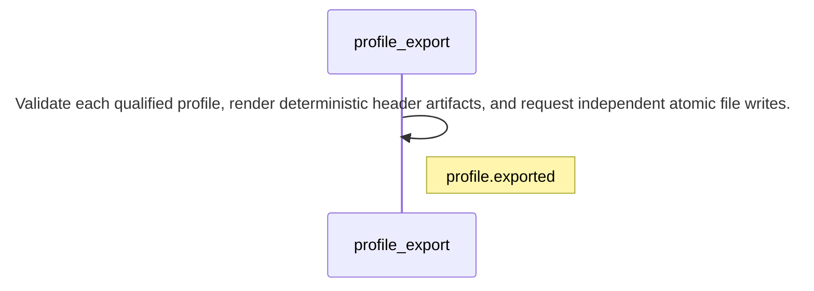

<!-- GENERATED BY govern-modular-event-architecture; DO NOT EDIT -->

# `profile_export`

## Structure

## Modules

| ID | Level | Role | Parent | Implementation Status | Purpose |
|---|---|---|---|---|---|
| `profile_export` | L1 | domain | `studio_application` | implemented | Convert each user-selected semantic profile into a separate deterministic C99 or C++17 header artifact. |

### `profile_export`

- **Purpose:** Convert each user-selected semantic profile into a separate deterministic C99 or C++17 header artifact.
- **Parent:** `studio_application`
- **Implementation Status:** `implemented`
- **Input Ports:** `profile.command`
- **Output Ports:** `profile.file-output`, `profile.events`
- **Emitted Events:** `profile.exported`
- **Owned State:** None
- **Side Effects:** None
- **Errors:** None
- **Invariants:** Every artifact contains one Profile struct, exact target numeric constants, and a machine-readable strict Score-greater-than-Threshold detector contract.; Default file names are stable dual_imu_collision_profile_kNNN.h names.; Every Profile records kernel depth, worst latency, three robustness margins, covered and excluded offsets, qualified speed interval, and exact condition tuples.
- **Entrypoints:** [`ProfileExportService`](../../src/dual_imu_collision_studio/domain/profile_export/service.py) (class)
- **Public Symbols:** [`ProfileCommandPort`](../../src/dual_imu_collision_studio/domain/profile_export/contracts.py) (protocol) [`ProfileFilePort`](../../src/dual_imu_collision_studio/domain/profile_export/contracts.py) (protocol) [`ProfileEventPort`](../../src/dual_imu_collision_studio/domain/profile_export/contracts.py) (protocol)

## Port Contracts

| ID | Owner | Direction | Kind | Timing | Description | Symbols |
|---|---|---|---|---|---|---|
| `profile.command` | `profile_export` | input | command | sync | Render and save an approved qualified profile.: Qualified semantic profile, language target, namespace, and destination. | `ProfileCommandPort` |
| `profile.file-output` | `profile_export` | output | dependency | sync | Save generated header text to a user-selected path.: Destination path, UTF-8 header text, and overwrite choice. | `ProfileFilePort` |
| `profile.events` | `profile_export` | output | event | sync | Publish successful profile export metadata.: File path, language, numeric type, and qualified speed range. | `ProfileEventPort` |

## Event Contracts

| ID | Owner | Delivery | Emitted when | Purpose | Consumers |
|---|---|---|---|---|---|
| `profile.exported` | `profile_export` | at-most-once | The file adapter confirms the complete write. | Report that the selected profile header was saved. | `studio_application`, `desktop_adapter` |

## Type Catalog

| ID | Owner | Declaration | Visibility | Semantic kind | Consumers | References |
|---|---|---|---|---|---|---|
| `profile-export-request` | `profile_export` | `ProfileExportRequest` (class, `src/dual_imu_collision_studio/domain/profile_export/model.py`) | cross-module | command | `studio_application`, `profile_export` | None |
| `condition-coverage` | `profile_export` | `ConditionCoverage` (class, `src/dual_imu_collision_studio/domain/profile_export/model.py`) | cross-module | domain-value | `studio_application`, `profile_export` | None |
| `semantic-profile` | `profile_export` | `SemanticProfile` (class, `src/dual_imu_collision_studio/domain/profile_export/model.py`) | cross-module | domain-value | `studio_application`, `profile_export` | None |
| `profile-header-artifact` | `profile_export` | `ProfileHeaderArtifact` (class, `src/dual_imu_collision_studio/domain/profile_export/model.py`) | cross-module | domain-value | `studio_application`, `profile_export` | None |
| `profile-export-service` | `profile_export` | `ProfileExportService` (class, `src/dual_imu_collision_studio/domain/profile_export/service.py`) | module-public | domain-value | `studio_application`, `profile_export` | None |
| `profile-command-port` | `profile_export` | `ProfileCommandPort` (class, `src/dual_imu_collision_studio/domain/profile_export/contracts.py`) | cross-module | port | `studio_application`, `profile_export` | None |
| `profile-file-port` | `profile_export` | `ProfileFilePort` (class, `src/dual_imu_collision_studio/domain/profile_export/contracts.py`) | cross-module | port | `profile_export`, `desktop_adapter` | None |
| `profile-event-port` | `profile_export` | `ProfileEventPort` (class, `src/dual_imu_collision_studio/domain/profile_export/contracts.py`) | cross-module | port | `studio_application`, `profile_export` | None |

## State Ownership

| ID | Owner | Declaration | Type | Visibility | Mutability | Read authority | Write authority |
|---|---|---|---|---|---|---|---|

## Cross-module Mapping

| Interaction | Producer | Consumer | Parent | Producer contract | Consumer contract | Mapping owner | State accessed | Allowed edges | Forbidden edges |
|---|---|---|---|---|---|---|---|---|---|

## End-to-End Flows

### `export-profile`

Generate one independent header artifact for every selected qualified kernel.

#### Flow Diagram

#### Ordered Steps

| # | Module | Action | Receives | Emits | State changes | Side effects |
|---|---|---|---|---|---|---|
| 1 | `profile_export` | Validate each qualified profile, render deterministic header artifacts, and request independent atomic file writes. | `profile.command` | `profile.exported` | None | Write selected header files through profile.file-output, replacing only files explicitly approved by the user. |

- **Success:** Separate C99 or C++17 profile headers are saved for all non-skipped kernels.

#### Execution efficiency

- Workload `profile-write`: `best-effort`; steps `export-profile.step-1`; profiles [`windows-desktop`](execution-windows-desktop.md).
