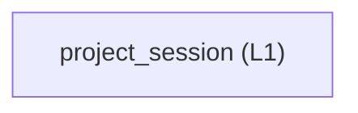

<!-- GENERATED BY govern-modular-event-architecture; DO NOT EDIT -->

# `project_session`

## Structure

## Modules

| ID | Level | Role | Parent | Implementation Status | Purpose |
|---|---|---|---|---|---|
| `project_session` | L1 | domain | `studio_application` | implemented | Own the versioned semantic project document, source-integrity rules, and transactional reopen/save contract. |

### `project_session`

- **Purpose:** Own the versioned semantic project document, source-integrity rules, and transactional reopen/save contract.
- **Parent:** `studio_application`
- **Implementation Status:** `implemented`
- **Input Ports:** `project.command`
- **Output Ports:** `project.file-storage`
- **Emitted Events:** None
- **Owned State:** None
- **Side Effects:** None
- **Errors:** None
- **Invariants:** Project documents never embed waveform sample arrays.; Every referenced source is identified by path, byte size, and SHA-256 before restored annotations can be committed.; In-progress Learning state is never represented as a resumable checkpoint.; Completed retained Profiles are optional and version-bound.; New-contract project documents accept finite positive data-derived Profile thresholds and restore exact interpolation provenance with source identity checks; old-project migration is outside SPEC-0009.; Editable Training mode and fixed-grid selections persist independently from immutable completed-run provenance. Pre-extension editable settings default to fixed-grid with empty selections, while legacy captured runs restore as optimized provenance without changing retained results.
- **Entrypoints:** [`ProjectSessionService`](../../src/dual_imu_collision_studio/domain/project_session/service.py) (class)
- **Public Symbols:** [`ProjectFilePort`](../../src/dual_imu_collision_studio/domain/project_session/contracts.py) (protocol) [`ProjectSessionService`](../../src/dual_imu_collision_studio/domain/project_session/service.py) (class)

## Port Contracts

| ID | Owner | Direction | Kind | Timing | Description | Symbols |
|---|---|---|---|---|---|---|
| `project.command` | `project_session` | input | command | sync | Validate a complete semantic project document for save or transactional reopen.: Versioned project identity, source references, mappings, annotations, templates, UI selection, and optional completed Profiles. | `ProjectSessionService` |
| `project.file-storage` | `project_session` | output | dependency | sync | Read or atomically replace one strict UTF-8 JSON .dicsproj artifact and compute source-file identity.: ProjectDocument values and source path fingerprints; no waveform samples or framework handles. | `ProjectFilePort` |

## Event Contracts

| ID | Owner | Delivery | Emitted when | Purpose | Consumers |
|---|---|---|---|---|---|

## Type Catalog

| ID | Owner | Declaration | Visibility | Semantic kind | Consumers | References |
|---|---|---|---|---|---|---|
| `project-source-reference` | `project_session` | `ProjectSourceReference` (class, `src/dual_imu_collision_studio/domain/project_session/model.py`) | cross-module | domain-value | `studio_application`, `project_session`, `desktop_adapter` | None |
| `project-document` | `project_session` | `ProjectDocument` (class, `src/dual_imu_collision_studio/domain/project_session/model.py`) | cross-module | domain-value | `studio_application`, `project_session`, `desktop_adapter` | `project-source-reference` |
| `project-session-service` | `project_session` | `ProjectSessionService` (class, `src/dual_imu_collision_studio/domain/project_session/service.py`) | module-public | domain-value | `studio_application`, `project_session`, `desktop_adapter` | None |
| `project-file-port` | `project_session` | `ProjectFilePort` (class, `src/dual_imu_collision_studio/domain/project_session/contracts.py`) | cross-module | port | `project_session`, `project_file_adapter` | None |

## State Ownership

| ID | Owner | Declaration | Type | Visibility | Mutability | Read authority | Write authority |
|---|---|---|---|---|---|---|---|

## Cross-module Mapping

| Interaction | Producer | Consumer | Parent | Producer contract | Consumer contract | Mapping owner | State accessed | Allowed edges | Forbidden edges |
|---|---|---|---|---|---|---|---|---|---|

## End-to-End Flows
