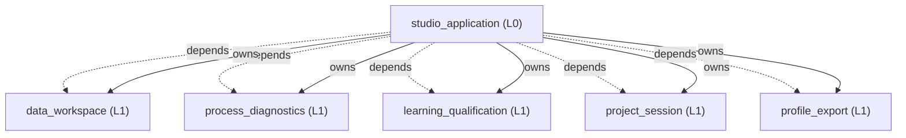
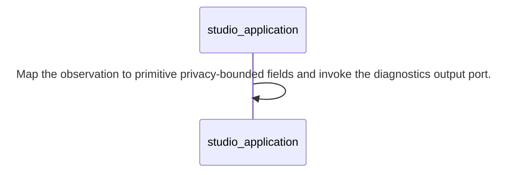
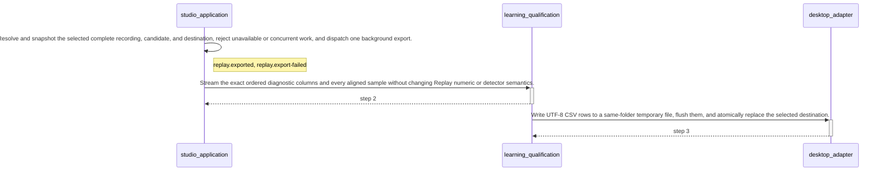
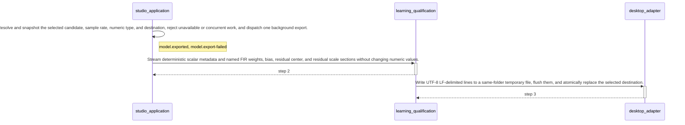

<!-- GENERATED BY govern-modular-event-architecture; DO NOT EDIT -->

# `studio_application`

## Structure



## Modules

| ID | Level | Role | Parent | Implementation Status | Purpose |
|---|---|---|---|---|---|
| `studio_application` | L0 | composition | `-` | implemented | Compose the desktop workflow, own annotation edit history, map immutable results between sibling domains, coordinate durable project reopen/save, and dispatch recording-only Replay evidence and model artifacts to bounded background exports. |
| `process_diagnostics` | L1 | domain | `studio_application` | implemented | Define privacy-bounded process and Learning diagnostic records independently of persistence technology. |
| `data_workspace` | L1 | domain | `studio_application` | implemented | Own imported recordings, mappings, test conditions, cycles, annotations, and derived Normal regions. |
| `learning_qualification` | L1 | domain | `studio_application` | implemented | Fit independently selected FIR and custom-depth MLP candidates, retain original fold kernels and replay exact frozen predictions across supplied conditions. |
| `profile_export` | L1 | domain | `studio_application` | implemented | Convert qualified frozen FIR profiles into deterministic C99 or C++17 headers and version-1 JSON model parameters. |
| `project_session` | L1 | domain | `studio_application` | implemented | Own the versioned semantic project document, source-integrity rules, and transactional reopen/save contract. |

### `studio_application`

- **Purpose:** Compose the desktop workflow, own annotation edit history, map immutable results between sibling domains, coordinate durable project reopen/save, and dispatch recording-only Replay evidence and model artifacts to bounded background exports.
- **Parent:** `-`
- **Implementation Status:** `implemented`
- **Input Ports:** None
- **Output Ports:** `replay.events`
- **Emitted Events:** `replay.exported`, `replay.export-failed`, `model.exported`, `model.export-failed`
- **Owned State:** None
- **Side Effects:** Start the Qt application and coordinate bounded background work. (`-`); Publish bounded process-lifecycle and Learning diagnostics through the application-owned diagnostics port. (`-`)
- **Errors:** None
- **Invariants:** Sibling domains communicate only through application-owned mappings.; Exactly one release composition root exists.; The QML engine retains the StudioController for the complete main-window lifetime.; QML coordinates are converted to sample indexes before domain validation.; Provisional annotation edits never enter Learning until the complete set is confirmed.; The application owns the session-local speed-to-template registry while data_workspace owns template semantics and projection.; The application restores its session-local manual annotation identity allocator above every persisted manual annotation identity before accepting post-open edits.; Successful reference activation clears both the primary selected annotation index and the selected-annotation set before publishing the refreshed UI state.; The application maps sibling-owned workspace and Profile values into project_session-owned persistence values without exposing JSON representations to functional domains.; Replay CSV export snapshots one selected recording and candidate, computes the complete continuous recording exactly once, and streams Learning-owned ReplayEvidence off the UI thread without display normalization.; Model TXT export snapshots one candidate and renders every governed model parameter exactly once off the UI thread.; The Candidate Dashboard execution log is session-only, capped at 10,000 accepted-run entries, never enters the project document or exported artifacts, and clears only on an accepted new Learning run, a direct session reset, or successful Open project replacement. Pointer presence anywhere inside the Execution Log pane pauses automatic following; pointer exit immediately positions the viewport at the newest entry, and log or layout updates keep the newest entry visible while the pointer is outside.; SPEC-0045 Open restores frozen models, existing condition aggregates and saved per-recording/collision details after source fingerprint and schema validation; it never invokes Training, Qualification or full score replay. Missing historical details display Not stored / N/A; stale bindings retain readable historical results but cannot grant current export qualification.; A cancelled Learning run commits one immutable partial result on the UI thread, remains visibly Cancelled, and exposes only fully qualified candidates or, when none qualifies, the existing minimum-total-error diagnostic subset in Candidate Dashboard and Analytical Replay.; Recording Qualification Results maps Learning-owned chronological per-Collision Detector Score SNR evidence into one display-only dB string without recomputation, status changes, persistence, or export.; Selected-kernel presentation exposes the Learning-owned stored Kernel Loss as Training loss without recomputation, uses N/A when historical evidence is unavailable, and shares one packaged DI icon between the in-app header and application-level window identity; Windows startup assigns the stable explicit DualIMU.CollisionStudio AppUserModelID before QGuiApplication construction so pythonw.exe launches retain the DI taskbar identity.; Completing Mapping Wizard preserves the Recordings ListView pixel viewport across the controller snapshot refresh and clamps it only when refreshed content makes the prior position invalid.; The parent maps frozen MLP layers to inert project data; model-family settings and results survive reopen without model retraining.; Mapping inventories per-IMU raw or filtered XYZ independently of algorithm selection. Training captures per-algorithm sources, rejects the complete requested batch on any incompatible recording, runs compatible methods serially in the existing analysis worker, and retains frozen result/source identity for replay and project reopen (SPEC-0033).; SPEC-0044 Training installs current-policy qualification evidence bound to frozen model, source, threshold and coverage. Project persistence preserves this identity; legacy or stale evidence requires frozen-model Qualification from Replay. JSON export performs background snapshot validation, rendering and atomic writes; busy state rejects duplicate export and project replacement until completion.; SPEC-0046 worker count is explicit one through eight, default one, application session state only and excluded from project/model persistence. Training locks this count. Auto, memory-preview worker/state and estimate busy dependencies are removed. Failure summaries retain bounded expandable/copyable details. See architecture/designs/SPEC-0046-pre-code-notes.md for ownership and flow.; Application-owned mapping serializes optional qualification_results from Learning values and reconstructs immutable Learning values only after ProjectSessionService validates structure. Existing qualification_evidence remains the sole current export admission proof, with its original policy and frozen-input checks.
- **Entrypoints:** [`main`](../../src/dual_imu_collision_studio/app.py) (function)
- **Public Symbols:** [`main`](../../src/dual_imu_collision_studio/app.py) (function)<br>[`StudioController`](../../src/dual_imu_collision_studio/adapters/desktop/controller.py) (class)

### `process_diagnostics`

- **Purpose:** Define privacy-bounded process and Learning diagnostic records independently of persistence technology.
- **Parent:** `studio_application`
- **Implementation Status:** `implemented`
- **Input Ports:** None
- **Output Ports:** `diagnostics.output`
- **Emitted Events:** None
- **Owned State:** None
- **Side Effects:** None
- **Errors:** None
- **Invariants:** Diagnostic contracts never contain waveform rows, annotations, or model coefficients.
- **Entrypoints:** [`DiagnosticsPort`](../../src/dual_imu_collision_studio/domain/process_diagnostics/contracts.py) (protocol)
- **Public Symbols:** [`DiagnosticsPort`](../../src/dual_imu_collision_studio/domain/process_diagnostics/contracts.py) (protocol)<br>[`DiagnosticStatus`](../../src/dual_imu_collision_studio/domain/process_diagnostics/model.py) (class)<br>[`NullDiagnostics`](../../src/dual_imu_collision_studio/domain/process_diagnostics/contracts.py) (class)

### `data_workspace`

- **Purpose:** Own imported recordings, mappings, test conditions, cycles, annotations, and derived Normal regions.
- **Parent:** `studio_application`
- **Implementation Status:** `implemented`
- **Input Ports:** `workspace.command`
- **Output Ports:** `workspace.tabular-input`, `workspace.events`
- **Emitted Events:** `workspace.changed`
- **Owned State:** None
- **Side Effects:** None
- **Errors:** None
- **Invariants:** Collision truth is determined only by waveform interval annotation.; Normal regions are derived and read-only.; After annotation confirmation, derived Normal regions exclude each Collision onset-through-150-ms inclusive response window, clipped at the containing Cycle, without changing the user's persisted Collision interval. Existing confirmation validation rejects Cycles that cross a true acquisition discontinuity; the derivation also defensively stops a response window at the first such discontinuity.; Every valid Cycle matches its reference template's non-negative Pick, Put, and Fork Collision count tuple; each class may be absent, but the total event count is at least one.; Use as Reference atomically confirms one valid source Cycle and its contained labels before activating a template for exactly one Robot Speed.; One manually confirmed destination Anchor Cycle deterministically generates remaining provisional Cycles from the reference cadence before event and Ignore projection.; Reference Ignore intervals retain their non-empty reasons, and every generated destination interval remains provisional until explicit confirmation.; Manual annotations take precedence over projected proposals and different Robot Speeds never share a template.; Every annotation interval has one non-empty session identity that is unique within its recording and survives confirmation-state replacement.; Reopening a project preserves every stored interval identity and allocates later manual interval identities without collision.; Ignore intervals carry a non-empty user reason.; Ignore/Collision overlap invalidates annotation confirmation and Learning; half-open adjacency and Ignore/Pick/Put overlap retain existing semantics.; Tabular input preserves measured rows and source bytes and linearly interpolates one through three missing samples on all six raw axes. The nearest nominal interval count determines missing count; four missing samples or repaired periods outside inclusive two-percent tolerance reject the recording.; Inserted samples carry index provenance and retain continuous FIR/detector state and ordinary activity-based eligibility. Annotation views show repair positions and counts without per-gap confirmation.; Internal and External IMU mappings pass selected source values through unchanged; acquisition-specific transforms remain outside the application.; Viewport waveform projection reads original mapped samples without mutation, uses shared contiguous half-open buckets for Internal and External IMUs, and emits a pixel-bounded immutable raw or Min/Max plus arithmetic-mean representation without changing annotation indexes.
- **Entrypoints:** [`WorkspaceService`](../../src/dual_imu_collision_studio/domain/data_workspace/service.py) (class)
- **Public Symbols:** [`WorkspaceCommandPort`](../../src/dual_imu_collision_studio/domain/data_workspace/contracts.py) (protocol)<br>[`TabularInputPort`](../../src/dual_imu_collision_studio/domain/data_workspace/contracts.py) (protocol)<br>[`WorkspaceEventPort`](../../src/dual_imu_collision_studio/domain/data_workspace/contracts.py) (protocol)<br>[`WaveformViewportProjection`](../../src/dual_imu_collision_studio/domain/data_workspace/model.py) (class)

### `learning_qualification`

- **Purpose:** Fit independently selected FIR and custom-depth MLP candidates, retain original fold kernels and replay exact frozen predictions across supplied conditions.
- **Parent:** `studio_application`
- **Implementation Status:** `implemented`
- **Input Ports:** `learning.command`, `learning.replay-export`, `learning.model-export`
- **Output Ports:** `learning.events`, `learning.history-execution`, `learning.execution`, `learning.replay-file-output`, `learning.model-file-output`
- **Emitted Events:** `learning.progressed`, `learning.completed`, `learning.cancelled`
- **Owned State:** None
- **Side Effects:** None
- **Errors:** None
- **Invariants:** Qualification always replays all supplied speeds.; Qualification always replays all supplied offsets, including offsets excluded from subsequent fitting rounds.; Every supplied speed and offset tuple retains exact activity denominators, false-trigger counts, collision detections, latency, and status provenance.; Every completed per-recording Qualification result retains all Collision Detector Score SNR values in chronological order. Signal is the finite Score peak in the existing inclusive 150-ms response window; shared noise is finite Score RMS outside annotated Collision and Ignore intervals. Invalid positive finite ratios remain unavailable and never change Qualification decisions.; SPEC-0011 uses configurable two-to-ten complete-Cycle folds, default three. Each recording has at least two valid Cycles; each condition has at least N. Every fold retains Training from every recording and Validation from every condition with per-condition counts differing by at most one. Counts/allocation failure stops the run; no automatic N reduction.; Each Start captures new settings and seed; each round captures a balanced fold map reused by every parameter candidate. Common Training and Validation targets support 128 ms History and exclude Collision and Ignore. Missing common targets skip the round without resampling or lowering History.; Candidate Loss is the maximum across conditions of the equal-fold average of Validation MSE, or the default half Training plus half Validation MSE. Target-cast original fold models supply prediction and subtraction before float64 squaring. Residual STD uses only final fitting rows.; Search jointly optimizes tap depth through 128 ms and continuous Ridge alpha from 1e-6 to 100; integer K from 2 to 32 is active only with optional Robust refit, default off. Coarse top two plus raw ties seed fine search. Neighbors project to bounds before deduplication; final steps are one tap, one K, and alpha factor 1.05 with configured relative improvement tolerance. All paths complete; each effective parameter/fold runs once per context.; Fixed-grid mode accepts only checked 4/8/16/32/64/128 ms History aliases and checked 1e-6/1e-4/0.01/1/100 Ridge alphas, deduplicates equal effective taps while preserving aliases, fixes Robust K to zero, and performs no coarse or fine search. Its effective Cartesian-product points reuse the same grouped N-fold Loss ranking, Validation allowance, fold-kernel selection, Qualification and fallback path as optimized mode; evaluated nonwinning points remain visible as CV-rejected evidence.; All valid parameters within the configured relative convergence tolerance of the minimum raw Parameter Loss are retained. Per-condition raw Validation allowance filters their original fold kernels, then each parameter retains every fold whose raw maximum-condition Kernel Loss exactly equals that parameter's raw minimum; rounded and second-place near ties are excluded. Every admitted parameter and fold completes Qualification before ranking. No final all-data refit or worse-parameter rescue occurs.; A passing collision detection has latency no greater than 150 ms from the confirmed collision interval start, inclusive, regardless of interval end.; A recording passes when at least one Collision interval exists, every Collision is detected within the inclusive 150 ms onset deadline, and every present Normal, Pick, or Put interval has zero false triggers. A missing Normal, Pick, or Put class is neutral; missing Collision evidence is COVERAGE_GAP.; A retained fallback is accepted only when its training range equals its qualified range.; Each outer round trains all remaining offsets and exhausts lowest-speed removal until the active range passes or only one speed remains. Success or exhaustion then excludes the smallest active offset and restores all supplied speeds.; Only full active-range matches enter the qualified pool. Ranking prefers more supplied speed strata, more active offsets, shorter taps, lower worst latency, larger robustness margin, then stable parameter order (SPEC-0008; ALG-0004).; Proven insufficient Training evidence skips only that round, preserves earlier retained winners, and continues suffix/offset progression. Unavailable scopes and reasons remain in progress and completed results; unclassified empty models and input/resource/unexpected execution failures are not missing evidence. Narrowly classified candidate numerical failures invalidate that full-N parameter configuration with parameter and fold diagnostics; they never fabricate Loss.; SPEC-0009 derives per-model N as the maximum of active-round Normal interval maxima and C as the minimum of active-round per-Collision window maxima. Collision uses its inclusive onset-through-150-ms window excluding Ignore. Search starts at N with step 0.5 and includes C, omits zero and duplicate target values, and never expands the bounds. Qualification still requires every labeled Collision to be detected.; Qualification, Replay, and exported Profile semantics use the strict detector predicate Score greater than Threshold; equality does not fill confirmation history. Release and re-arm remain strictly below release_ratio times Threshold.; Collision response evidence is the fixed onset-through-150-ms window minus Ignore samples. Preserve timestamps and retain eligible samples after Ignore; do not extend or shorten the absolute deadline, compress time, or reset detector state. Actual Collision annotations still cannot overlap Ignore.; Derived Normal evidence and Collision acceptance evidence use the same onset-through-150-ms boundary, so one sample cannot belong to both classes for the same Collision.; Missing whole-round bound evidence skips that round; C below N or no positive candidates skips that model with bounds and reason. Existing fallback and earlier qualified results are retained. Numerical failures are never evidence shortages.; For one fixed History, frozen model, target numeric type, Score Mode, and recording, normalized detector scores are computed once and reused across Threshold and Confirmation candidates without crossing the frozen-fold-kernel lifetime.; Diagnostic ranking compares retained selected fold-kernel results over every supplied recording by total false trigger events plus missed collision intervals, then finite worst collision latency, retaining all exact ties.; Diagnostic-only winners are never exportable Profiles.; Replay CSV serialization preserves full-resolution sample alignment and emits the exact governed diagnostic header order without substituting display-only zeroes.; Training uses only Cycle-contained Normal Robot Motion, Robot Pick, and Robot Put samples; Collision, Ignore, and Cycle-external samples are excluded and split FIR history.; Replay prediction and detector arithmetic start at the first sample with unavailable Internal FIR history initialized to zero. Numeric startup scores participate normally; successfully interpolated gaps preserve FIR and detector continuity.; Ignore never resets or pauses detector state; Ignore evidence remains visible but is excluded from Training and qualification pass or fail counts only.; Qualification counts false triggers in every non-Ignore Normal, Pick, Put, and Cycle-external sample; Cycle-external events aggregate into normal_false_events for compatibility.; Model TXT serialization emits deterministic scalar metadata, FIR weights, bias, residual center, and residual scale without changing stored project or profile schemas.; Search and fold-selection progress publishes typed Loss evidence; every retained candidate preserves the exact ordered per-recording Qualification metrics used by its condition aggregates.; Cancellation retains only candidates whose complete Qualification evidence committed before cancellation observation. Completed qualified candidates remain selectable; only when none qualifies does the existing minimum-total-error, finite-latency, exact-tie diagnostic ranking become visible. The terminal state remains Cancelled.; FIR and MLP sample and select independently; model-family results retain separate seeds, fold maps and immutable kernels.; MLP hidden depth is a custom positive integer defaulting to two; each layer independently selects widths 4,8,16,32,64,128. Only selected Cartesian combinations run; no final all-data refit.; SPEC-0030 adds one-sensor Ridge self-prediction using only lags 1..L, adopted causal SOS preprocessing, explicit warmup, continuous Ignore history and separate frozen model identity.; SPEC-0044 Training Qualification and Replay share strict 1_OF_1 collision triggering and fixed 0.8/50 ms continuous-valid-time rearm. Invalid data or discontinuity clears quiet time without releasing the latch. Frozen-model requalification never fits or narrows the required original speed/offset coverage.; SPEC-0045 captures chronological collision decisions, trigger indices/times, latency, margins and SNR unavailable reasons in the same Qualification pass. Retained candidates carry their actual policy. Numerical detection and Training are unchanged.; SPEC-0046 FIR fitting and prediction borrow source samples and construct at most eight MiB of float64 feature rows per block. Ridge accumulates centered statistics and Gram/RHS by block, with unchanged alpha, degeneracy, valid-row, channel/lag order, target rounding, exact residual calibration and robust selection contracts. Dense features remain explicit for MLP. Frozen results never retain lazy feature rows, block buffers or original fitting samples.
- **Entrypoints:** [`LearningService`](../../src/dual_imu_collision_studio/domain/learning/service.py) (class)
- **Public Symbols:** [`LearningCommandPort`](../../src/dual_imu_collision_studio/domain/learning/contracts.py) (protocol)<br>[`LearningEventPort`](../../src/dual_imu_collision_studio/domain/learning/contracts.py) (protocol)<br>[`HistoryExecutionPort`](../../src/dual_imu_collision_studio/domain/learning/contracts.py) (protocol)<br>[`ReplayCsvFilePort`](../../src/dual_imu_collision_studio/domain/learning/contracts.py) (protocol)<br>[`ModelTextFilePort`](../../src/dual_imu_collision_studio/domain/learning/contracts.py) (protocol)<br>[`LearningService`](../../src/dual_imu_collision_studio/domain/learning/service.py) (class)<br>[`LearningExecutionPort`](../../src/dual_imu_collision_studio/domain/learning/contracts.py) (class)<br>[`service_for_dataset`](../../src/dual_imu_collision_studio/domain/learning/self_imu.py) (function)<br>[`DeploymentQualification`](../../src/dual_imu_collision_studio/domain/learning/deployment.py) (class)<br>[`replay_common_events`](../../src/dual_imu_collision_studio/domain/learning/deployment.py) (function)<br>[`deployment_identity`](../../src/dual_imu_collision_studio/domain/learning/deployment.py) (function)

### `profile_export`

- **Purpose:** Convert qualified frozen FIR profiles into deterministic C99 or C++17 headers and version-1 JSON model parameters.
- **Parent:** `studio_application`
- **Implementation Status:** `implemented`
- **Input Ports:** `profile.command`
- **Output Ports:** `profile.file-output`, `profile.events`
- **Emitted Events:** `profile.exported`
- **Owned State:** None
- **Side Effects:** None
- **Errors:** None
- **Invariants:** Every artifact contains one Profile struct, exact target numeric constants, and a machine-readable strict Score-greater-than-Threshold detector contract.; Default file names are stable dual_imu_collision_profile_kNNN.h names.; Every Profile records kernel depth, worst latency, three robustness margins, covered and excluded offsets, qualified speed interval, and exact condition tuples.; SPEC-0040 schema-1 model JSON omits release_ratio and release_quiet_time_s; event release belongs to common firmware policy and execution identity excludes display names.
- **Entrypoints:** [`ProfileExportService`](../../src/dual_imu_collision_studio/domain/profile_export/service.py) (class)
- **Public Symbols:** [`ProfileCommandPort`](../../src/dual_imu_collision_studio/domain/profile_export/contracts.py) (protocol)<br>[`ProfileFilePort`](../../src/dual_imu_collision_studio/domain/profile_export/contracts.py) (protocol)<br>[`ProfileEventPort`](../../src/dual_imu_collision_studio/domain/profile_export/contracts.py) (protocol)

### `project_session`

- **Purpose:** Own the versioned semantic project document, source-integrity rules, and transactional reopen/save contract.
- **Parent:** `studio_application`
- **Implementation Status:** `implemented`
- **Input Ports:** `project.command`
- **Output Ports:** `project.file-storage`
- **Emitted Events:** None
- **Owned State:** None
- **Side Effects:** None
- **Errors:** None
- **Invariants:** Project documents never embed waveform sample arrays.; Every referenced source is identified by path, byte size, and SHA-256 before restored annotations can be committed.; In-progress Learning state is never represented as a resumable checkpoint.; Completed retained Profiles are optional and version-bound.; New-contract project documents accept finite positive data-derived Profile thresholds and restore exact interpolation provenance with source identity checks; old-project migration is outside SPEC-0009.; Editable Training mode and fixed-grid selections persist independently from immutable completed-run provenance. Pre-extension editable settings default to fixed-grid with empty selections, while legacy captured runs restore as optimized provenance without changing retained results.; SPEC-0045 optional schema-1 qualification_results contains validated event-level immutable results and model/input/policy bindings. Missing historical details remain unavailable; malformed or unsupported results reject the whole transaction. No per-sample scores, states or waveforms are persisted.
- **Entrypoints:** [`ProjectSessionService`](../../src/dual_imu_collision_studio/domain/project_session/service.py) (class)
- **Public Symbols:** [`ProjectFilePort`](../../src/dual_imu_collision_studio/domain/project_session/contracts.py) (protocol)<br>[`ProjectSessionService`](../../src/dual_imu_collision_studio/domain/project_session/service.py) (class)

## Port Contracts

| ID | Owner | Direction | Kind | Timing | Description | Symbols |
|---|---|---|---|---|---|---|
| `project.command` | `project_session` | input | command | sync | Validate a complete semantic project document for save or transactional reopen.: Versioned project identity, source references, mappings, annotations, templates, UI selection, and optional completed Profiles. | `ProjectSessionService` |
| `project.file-storage` | `project_session` | output | dependency | sync | Read or atomically replace one strict UTF-8 JSON .dicsproj artifact and compute source-file identity.: ProjectDocument values and source path fingerprints; no waveform samples or framework handles. | `ProjectFilePort` |
| `workspace.command` | `data_workspace` | input | command | sync | Import, configure, annotate, or validate workspace data.: Semantic recording, mapping, condition, atomic reference activation, destination Anchor Cycle, cadence generation, and same-speed annotation projection commands. | `WorkspaceCommandPort` |
| `workspace.tabular-input` | `data_workspace` | output | dependency | sync | Read selected tabular data through a domain-owned contract.: Column names, row values, and source metadata. | `TabularInputPort` |
| `workspace.events` | `data_workspace` | output | event | sync | Publish a committed workspace snapshot.: Immutable semantic workspace snapshot. | `WorkspaceEventPort` |
| `learning.command` | `learning_qualification` | input | command | async | Start or cancel one bounded learning and qualification run.: Workspace snapshot, numeric type, captured Training mode, mode-specific candidate policy, grouped-CV settings, and memory limit. | `LearningCommandPort` |
| `learning.events` | `learning_qualification` | output | event | async | Publish learning progress and committed qualification results.: Progress stage, candidate counts, typed parameter and kernel Loss evidence, speed coverage, per-recording Qualification results, qualified ranking, minimum-misjudgment diagnostic ranking, selected profile, and an immutable completed-candidate snapshot when cancellation terminates accepted work. | `LearningEventPort` |
| `learning.history-execution` | `learning_qualification` | output | dependency | async | Execute the four independent requested-History jobs for one fallback round without exposing process technology to Learning.: Immutable History jobs, ordered results, bounded progress, typed failures, attempt durations, and process-tree Peak RSS evidence. | `HistoryExecutionPort` |
| `learning.replay-export` | `learning_qualification` | input | command | async | Render one selected candidate and complete recording as the governed full-resolution diagnostic CSV schema.: Immutable ReplayEvidence containing aligned raw, FIR, residual, detector score, threshold, ratio, state, and trigger values. | `LearningService` |
| `learning.replay-file-output` | `learning_qualification` | output | dependency | sync | Atomically replace one user-selected Replay CSV destination without exposing filesystem technology to Learning.: Destination path and a deterministic stream of UTF-8 CSV rows rendered from one immutable ReplayEvidence value. | `ReplayCsvFilePort` |
| `learning.model-export` | `learning_qualification` | input | command | async | Render one selected retained candidate as the governed deterministic Model TXT schema.: Candidate identifier, sample rate, numeric type, detector parameters, FIR weights, bias, residual center, and residual scale. | `LearningService` |
| `learning.model-file-output` | `learning_qualification` | output | dependency | sync | Atomically replace one user-selected Model TXT destination without exposing filesystem technology to Learning.: Destination path and a deterministic stream of UTF-8 LF-delimited Model TXT lines. | `ModelTextFilePort` |
| `profile.command` | `profile_export` | input | command | sync | Render and save an approved qualified profile.: Qualified semantic profile, language target, namespace, and destination. | `ProfileCommandPort` |
| `profile.file-output` | `profile_export` | output | dependency | sync | Save generated header text to a user-selected path.: Destination path, UTF-8 header text, and overwrite choice. | `ProfileFilePort` |
| `profile.events` | `profile_export` | output | event | sync | Publish successful profile export metadata.: File path, language, numeric type, and qualified speed range. | `ProfileEventPort` |
| `diagnostics.output` | `process_diagnostics` | output | dependency | sync | Persist bounded process-lifecycle, Learning-stage, and Qt/QML diagnostic evidence.: Immutable diagnostic status plus primitive stage, progress, Speed, Offset, failure, and runtime metadata without dataset payloads. | `DiagnosticsPort` |
| `replay.events` | `studio_application` | output | event | async | Publish the terminal outcome of one accepted background Replay CSV or Model TXT export.: Artifact kind plus saved destination path on success or a bounded failure message on failure. | `StudioController` |
| `learning.execution` | `learning_qualification` | output | query | sync | Execute complete candidate-fold or recording jobs under one globally bounded queue.: Immutable dataset and fold jobs or independent complete recording jobs; ordered results and resource evidence. | `LearningExecutionPort` |

## Event Contracts

| ID | Owner | Delivery | Emitted when | Purpose | Consumers |
|---|---|---|---|---|---|
| `workspace.changed` | `data_workspace` | at-most-once | Import, mapping, condition, cycle, or annotation validation has committed. | Report a committed semantic workspace change. | `studio_application` |
| `learning.progressed` | `learning_qualification` | at-most-once | A progress interval or learning stage boundary is reached. | Report bounded progress without exposing mutable worker state. | `studio_application`, `desktop_adapter` |
| `learning.completed` | `learning_qualification` | at-most-once | Exact typed replay and fallback evaluation have completed. | Report deterministic qualification and ranking results. | `studio_application`, `desktop_adapter` |
| `learning.cancelled` | `learning_qualification` | at-most-once | Accepted Learning work observes cancellation after atomically freezing its current partial QualificationResult. | Report user cancellation together with the last committed complete-candidate result. | `studio_application`, `desktop_adapter` |
| `profile.exported` | `profile_export` | at-most-once | The file adapter confirms the complete write. | Report that the selected profile header was saved. | `studio_application`, `desktop_adapter` |
| `replay.exported` | `studio_application` | at-most-once | The background writer has flushed the complete temporary file and atomically replaced the destination. | Report that one accepted Replay CSV export committed its destination. | `desktop_adapter` |
| `replay.export-failed` | `studio_application` | at-most-once | CSV rendering, temporary-file flushing, or atomic replacement raises a bounded failure. | Report that one accepted Replay CSV export failed without replacing its destination. | `desktop_adapter` |
| `model.exported` | `studio_application` | at-most-once | The background writer has flushed the complete temporary file and atomically replaced the destination. | Report that one accepted Model TXT export committed its destination. | `desktop_adapter` |
| `model.export-failed` | `studio_application` | at-most-once | Model rendering, temporary-file flushing, or atomic replacement raises a bounded failure. | Report that one accepted Model TXT export failed without replacing its destination. | `desktop_adapter` |

## Type Catalog

| ID | Owner | Declaration | Visibility | Semantic kind | Consumers | References |
|---|---|---|---|---|---|---|
| `diagnostic-status` | `process_diagnostics` | `DiagnosticStatus` (class, `src/dual_imu_collision_studio/domain/process_diagnostics/model.py`) | cross-module | domain-value | `process_diagnostics`, `studio_application`, `desktop_adapter` | None |
| `diagnostics-port` | `process_diagnostics` | `DiagnosticsPort` (class, `src/dual_imu_collision_studio/domain/process_diagnostics/contracts.py`) | cross-module | port | `process_diagnostics`, `studio_application`, `desktop_adapter` | `diagnostic-status`, `learning-timing-evidence` |
| `learning-timing-evidence` | `process_diagnostics` | `LearningTimingEvidence` (class, `src/dual_imu_collision_studio/domain/process_diagnostics/model.py`) | cross-module | domain-value | `process_diagnostics`, `studio_application`, `desktop_adapter` | None |
| `null-diagnostics` | `process_diagnostics` | `NullDiagnostics` (class, `src/dual_imu_collision_studio/domain/process_diagnostics/contracts.py`) | cross-module | port | `studio_application` | `diagnostics-port`, `diagnostic-status` |
| `workspace-snapshot` | `data_workspace` | `WorkspaceSnapshot` (class, `src/dual_imu_collision_studio/domain/data_workspace/model.py`) | cross-module | domain-value | `studio_application` | None |
| `header-proposal` | `data_workspace` | `HeaderProposal` (class, `src/dual_imu_collision_studio/domain/data_workspace/model.py`) | cross-module | domain-value | `studio_application`, `data_workspace`, `tabular_adapter` | None |
| `learning-request` | `learning_qualification` | `LearningRequest` (class, `src/dual_imu_collision_studio/domain/learning/model.py`) | cross-module | command | `studio_application`, `learning_qualification` | `learning-settings` |
| `qualification-result` | `learning_qualification` | `QualificationResult` (class, `src/dual_imu_collision_studio/domain/learning/model.py`) | cross-module | domain-value | `studio_application` | `qualified-candidate`, `learning-progress` |
| `learning-cancelled` | `learning_qualification` | `LearningCancelled` (class, `src/dual_imu_collision_studio/domain/learning/model.py`) | cross-module | domain-value | `learning_qualification`, `studio_application` | `qualification-result` |
| `profile-export-request` | `profile_export` | `ProfileExportRequest` (class, `src/dual_imu_collision_studio/domain/profile_export/model.py`) | cross-module | command | `studio_application`, `profile_export` | None |
| `activity-kind` | `data_workspace` | `ActivityKind` (class, `src/dual_imu_collision_studio/domain/data_workspace/model.py`) | cross-module | domain-value | `studio_application`, `data_workspace` | None |
| `annotation-interval` | `data_workspace` | `AnnotationInterval` (class, `src/dual_imu_collision_studio/domain/data_workspace/model.py`) | cross-module | domain-value | `studio_application`, `data_workspace` | `activity-kind` |
| `annotation-template-event` | `data_workspace` | `AnnotationTemplateEvent` (class, `src/dual_imu_collision_studio/domain/data_workspace/model.py`) | cross-module | domain-value | `studio_application`, `data_workspace` | `activity-kind` |
| `annotation-template` | `data_workspace` | `AnnotationTemplate` (class, `src/dual_imu_collision_studio/domain/data_workspace/model.py`) | cross-module | domain-value | `studio_application`, `data_workspace` | `annotation-template-event` |
| `test-condition` | `data_workspace` | `TestCondition` (class, `src/dual_imu_collision_studio/domain/data_workspace/model.py`) | cross-module | domain-value | `studio_application`, `data_workspace` | `activity-kind` |
| `recording` | `data_workspace` | `Recording` (class, `src/dual_imu_collision_studio/domain/data_workspace/model.py`) | cross-module | domain-value | `studio_application`, `data_workspace` | `activity-kind` |
| `column-mapping` | `data_workspace` | `ColumnMapping` (class, `src/dual_imu_collision_studio/domain/data_workspace/model.py`) | cross-module | domain-value | `studio_application`, `data_workspace` | `activity-kind` |
| `imported-samples` | `data_workspace` | `ImportedSamples` (class, `src/dual_imu_collision_studio/domain/data_workspace/model.py`) | cross-module | domain-value | `studio_application`, `data_workspace`, `tabular_adapter` | None |
| `waveform-viewport-projection` | `data_workspace` | `WaveformViewportProjection` (class, `src/dual_imu_collision_studio/domain/data_workspace/model.py`) | cross-module | domain-value | `studio_application` | None |
| `workspace-service` | `data_workspace` | `WorkspaceService` (class, `src/dual_imu_collision_studio/domain/data_workspace/service.py`) | module-public | domain-value | `studio_application`, `data_workspace` | `activity-kind` |
| `workspace-command-port` | `data_workspace` | `WorkspaceCommandPort` (class, `src/dual_imu_collision_studio/domain/data_workspace/contracts.py`) | cross-module | port | `studio_application`, `data_workspace` | `activity-kind` |
| `tabular-input-port` | `data_workspace` | `TabularInputPort` (class, `src/dual_imu_collision_studio/domain/data_workspace/contracts.py`) | cross-module | port | `data_workspace`, `tabular_adapter` | `activity-kind` |
| `workspace-event-port` | `data_workspace` | `WorkspaceEventPort` (class, `src/dual_imu_collision_studio/domain/data_workspace/contracts.py`) | cross-module | port | `studio_application`, `data_workspace` | `activity-kind` |
| `history-spec` | `learning_qualification` | `HistorySpec` (class, `src/dual_imu_collision_studio/domain/learning/model.py`) | cross-module | domain-value | `studio_application`, `learning_qualification` | `single-imu-settings` |
| `candidate-plan` | `learning_qualification` | `CandidatePlan` (class, `src/dual_imu_collision_studio/domain/learning/model.py`) | cross-module | domain-value | `studio_application`, `learning_qualification` | `single-imu-settings` |
| `history-job` | `learning_qualification` | `HistoryJob` (class, `src/dual_imu_collision_studio/domain/learning/model.py`) | cross-module | domain-value | `learning_qualification`, `history_worker_adapter` | `single-imu-settings` |
| `history-execution-error` | `learning_qualification` | `HistoryExecutionError` (class, `src/dual_imu_collision_studio/domain/learning/model.py`) | cross-module | domain-value | `studio_application`, `learning_qualification`, `history_worker_adapter` | `single-imu-settings` |
| `hardware-memory-insufficient-error` | `learning_qualification` | `HardwareMemoryInsufficientError` (class, `src/dual_imu_collision_studio/domain/learning/model.py`) | cross-module | domain-value | `studio_application`, `learning_qualification`, `history_worker_adapter` | `history-execution-error` |
| `insufficient-training-evidence` | `learning_qualification` | `InsufficientTrainingEvidence` (class, `src/dual_imu_collision_studio/domain/learning/model.py`) | module-public | domain-value | `learning_qualification` | `single-imu-settings` |
| `history-job-result` | `learning_qualification` | `HistoryJobResult` (class, `src/dual_imu_collision_studio/domain/learning/model.py`) | cross-module | domain-value | `learning_qualification`, `history_worker_adapter` | `single-imu-settings` |
| `history-batch-result` | `learning_qualification` | `HistoryBatchResult` (class, `src/dual_imu_collision_studio/domain/learning/model.py`) | cross-module | domain-value | `learning_qualification`, `history_worker_adapter` | `single-imu-settings` |
| `history-attempt-timing` | `learning_qualification` | `HistoryAttemptTiming` (class, `src/dual_imu_collision_studio/domain/learning/model.py`) | cross-module | domain-value | `studio_application`, `learning_qualification`, `history_worker_adapter` | `single-imu-settings` |
| `history-worker-progress` | `learning_qualification` | `HistoryWorkerProgress` (class, `src/dual_imu_collision_studio/domain/learning/model.py`) | cross-module | domain-value | `studio_application`, `learning_qualification`, `history_worker_adapter` | `single-imu-settings` |
| `fir-matrix-evidence` | `learning_qualification` | `FirMatrixEvidence` (class, `src/dual_imu_collision_studio/domain/learning/model.py`) | private | domain-value | `learning_qualification` | `single-imu-settings` |
| `history-fold-evidence` | `learning_qualification` | `HistoryFoldEvidence` (class, `src/dual_imu_collision_studio/domain/learning/model.py`) | private | domain-value | `learning_qualification` | `single-imu-settings` |
| `learning-log-evidence` | `learning_qualification` | `LearningLogEvidence` (class, `src/dual_imu_collision_studio/domain/learning/model.py`) | cross-module | domain-value | `learning_qualification`, `studio_application` | `parameter-point` |
| `learning-progress` | `learning_qualification` | `LearningProgress` (class, `src/dual_imu_collision_studio/domain/learning/model.py`) | cross-module | domain-value | `studio_application`, `learning_qualification` | `learning-log-evidence` |
| `learning-interval` | `learning_qualification` | `LearningInterval` (class, `src/dual_imu_collision_studio/domain/learning/model.py`) | cross-module | domain-value | `studio_application`, `learning_qualification` | `single-imu-settings` |
| `learning-recording` | `learning_qualification` | `LearningRecording` (class, `src/dual_imu_collision_studio/domain/learning/model.py`) | cross-module | domain-value | `studio_application`, `learning_qualification` | `single-imu-settings` |
| `learning-dataset` | `learning_qualification` | `LearningDataset` (class, `src/dual_imu_collision_studio/domain/learning/model.py`) | cross-module | domain-value | `studio_application`, `learning_qualification` | `single-imu-settings` |
| `fit-evidence` | `learning_qualification` | `FitEvidence` (class, `src/dual_imu_collision_studio/domain/learning/model.py`) | cross-module | domain-value | `studio_application`, `learning_qualification` | `single-imu-settings` |
| `cycle-fold-group` | `learning_qualification` | `CycleFoldGroup` (class, `src/dual_imu_collision_studio/domain/learning/model.py`) | cross-module | domain-value | `studio_application`, `learning_qualification` | `single-imu-settings` |
| `cross-validation-fold` | `learning_qualification` | `CrossValidationFold` (class, `src/dual_imu_collision_studio/domain/learning/model.py`) | cross-module | domain-value | `studio_application`, `learning_qualification` | `single-imu-settings` |
| `cross-validation-plan` | `learning_qualification` | `CrossValidationPlan` (class, `src/dual_imu_collision_studio/domain/learning/model.py`) | cross-module | domain-value | `studio_application`, `learning_qualification` | `single-imu-settings` |
| `cross-validated-model` | `learning_qualification` | `CrossValidatedModel` (class, `src/dual_imu_collision_studio/domain/learning/model.py`) | cross-module | domain-value | `studio_application`, `learning_qualification` | `single-imu-settings` |
| `detector-config` | `learning_qualification` | `DetectorConfig` (class, `src/dual_imu_collision_studio/domain/learning/model.py`) | cross-module | domain-value | `studio_application`, `learning_qualification` | `single-imu-settings` |
| `detector-trace` | `learning_qualification` | `DetectorTrace` (class, `src/dual_imu_collision_studio/domain/learning/model.py`) | cross-module | domain-value | `studio_application`, `learning_qualification` | `single-imu-settings` |
| `replay-evidence` | `learning_qualification` | `ReplayEvidence` (class, `src/dual_imu_collision_studio/domain/learning/model.py`) | cross-module | domain-value | `studio_application`, `learning_qualification` | `detector-trace`, `qualified-candidate`, `learning-recording` |
| `recording-qualification` | `learning_qualification` | `RecordingQualification` (class, `src/dual_imu_collision_studio/domain/learning/model.py`) | cross-module | domain-value | `learning_qualification`, `studio_application` | `collision-qualification` |
| `qualified-candidate` | `learning_qualification` | `QualifiedCandidate` (class, `src/dual_imu_collision_studio/domain/learning/model.py`) | cross-module | domain-value | `studio_application`, `learning_qualification` | `recording-qualification` |
| `condition-qualification` | `learning_qualification` | `ConditionQualification` (class, `src/dual_imu_collision_studio/domain/learning/model.py`) | cross-module | domain-value | `studio_application`, `learning_qualification` | `single-imu-settings` |
| `offset-qualification` | `learning_qualification` | `OffsetQualification` (class, `src/dual_imu_collision_studio/domain/learning/model.py`) | cross-module | domain-value | `studio_application`, `learning_qualification` | `single-imu-settings` |
| `fallback-state` | `learning_qualification` | `FallbackState` (class, `src/dual_imu_collision_studio/domain/learning/model.py`) | cross-module | domain-value | `studio_application`, `learning_qualification` | `single-imu-settings` |
| `fallback-action` | `learning_qualification` | `FallbackAction` (class, `src/dual_imu_collision_studio/domain/learning/model.py`) | cross-module | domain-value | `studio_application`, `learning_qualification` | `single-imu-settings` |
| `fallback-transition` | `learning_qualification` | `FallbackTransition` (class, `src/dual_imu_collision_studio/domain/learning/model.py`) | cross-module | domain-value | `studio_application`, `learning_qualification` | `single-imu-settings` |
| `frozen-fir-model` | `learning_qualification` | `FrozenFirModel` (class, `src/dual_imu_collision_studio/domain/learning/model.py`) | cross-module | domain-value | `studio_application`, `learning_qualification` | `single-imu-settings` |
| `learning-service` | `learning_qualification` | `LearningService` (class, `src/dual_imu_collision_studio/domain/learning/service.py`) | module-public | domain-value | `studio_application`, `learning_qualification` | `single-imu-settings` |
| `learning-command-port` | `learning_qualification` | `LearningCommandPort` (class, `src/dual_imu_collision_studio/domain/learning/contracts.py`) | cross-module | port | `studio_application`, `learning_qualification` | `single-imu-settings` |
| `learning-event-port` | `learning_qualification` | `LearningEventPort` (class, `src/dual_imu_collision_studio/domain/learning/contracts.py`) | cross-module | port | `studio_application`, `learning_qualification` | `single-imu-settings` |
| `history-execution-port` | `learning_qualification` | `HistoryExecutionPort` (class, `src/dual_imu_collision_studio/domain/learning/contracts.py`) | cross-module | port | `learning_qualification`, `history_worker_adapter` | `single-imu-settings` |
| `replay-csv-file-port` | `learning_qualification` | `ReplayCsvFilePort` (class, `src/dual_imu_collision_studio/domain/learning/contracts.py`) | cross-module | port | `learning_qualification`, `studio_application`, `desktop_adapter` | `single-imu-settings` |
| `model-text-file-port` | `learning_qualification` | `ModelTextFilePort` (class, `src/dual_imu_collision_studio/domain/learning/contracts.py`) | cross-module | port | `learning_qualification`, `studio_application`, `desktop_adapter` | `single-imu-settings` |
| `training-mode` | `learning_qualification` | `TrainingMode` (enum, `src/dual_imu_collision_studio/domain/learning/model.py`) | cross-module | domain-value | `learning_qualification`, `studio_application`, `history_worker_adapter` | None |
| `learning-settings` | `learning_qualification` | `LearningSettings` (class, `src/dual_imu_collision_studio/domain/learning/model.py`) | cross-module | domain-value | `learning_qualification`, `studio_application`, `history_worker_adapter` | `training-mode` |
| `parameter-point` | `learning_qualification` | `ParameterPoint` (class, `src/dual_imu_collision_studio/domain/learning/model.py`) | cross-module | domain-value | `learning_qualification`, `studio_application`, `history_worker_adapter` | None |
| `condition-loss` | `learning_qualification` | `ConditionLoss` (class, `src/dual_imu_collision_studio/domain/learning/model.py`) | cross-module | domain-value | `learning_qualification`, `studio_application`, `history_worker_adapter` | None |
| `fold-job` | `learning_qualification` | `FoldJob` (class, `src/dual_imu_collision_studio/domain/learning/model.py`) | cross-module | domain-value | `learning_qualification`, `studio_application`, `history_worker_adapter` | `parameter-point`, `learning-settings`, `cycle-fold-group` |
| `fold-result` | `learning_qualification` | `FoldResult` (class, `src/dual_imu_collision_studio/domain/learning/model.py`) | cross-module | domain-value | `learning_qualification`, `studio_application`, `history_worker_adapter` | `parameter-point`, `condition-loss`, `frozen-fir-model` |
| `parameter-result` | `learning_qualification` | `ParameterResult` (class, `src/dual_imu_collision_studio/domain/learning/model.py`) | cross-module | domain-value | `learning_qualification`, `studio_application`, `history_worker_adapter` | `parameter-point`, `fold-result` |
| `kernel-training-evidence` | `learning_qualification` | `KernelTrainingEvidence` (class, `src/dual_imu_collision_studio/domain/learning/model.py`) | cross-module | domain-value | `learning_qualification`, `studio_application`, `history_worker_adapter` | `learning-settings`, `condition-loss`, `cross-validation-plan` |
| `round-provenance` | `learning_qualification` | `RoundProvenance` (class, `src/dual_imu_collision_studio/domain/learning/model.py`) | cross-module | domain-value | `learning_qualification`, `studio_application`, `history_worker_adapter` | `cross-validation-plan` |
| `run-provenance` | `learning_qualification` | `RunProvenance` (class, `src/dual_imu_collision_studio/domain/learning/model.py`) | cross-module | domain-value | `learning_qualification`, `studio_application`, `history_worker_adapter` | `learning-settings`, `round-provenance` |
| `fold-memory-estimate` | `learning_qualification` | `FoldMemoryEstimate` (class, `src/dual_imu_collision_studio/domain/learning/memory.py`) | cross-module | domain-value | `learning_qualification`, `history_worker_adapter` | None |
| `evidence-row-counts` | `learning_qualification` | `EvidenceRowCounts` (class, `src/dual_imu_collision_studio/domain/learning/memory.py`) | private | domain-value | `learning_qualification` | None |
| `execution-batch` | `learning_qualification` | `ExecutionBatch` (class, `src/dual_imu_collision_studio/domain/learning/model.py`) | cross-module | domain-value | `learning_qualification`, `studio_application`, `history_worker_adapter` | `fold-result` |
| `recording-job` | `learning_qualification` | `RecordingJob` (class, `src/dual_imu_collision_studio/domain/learning/model.py`) | cross-module | domain-value | `learning_qualification`, `studio_application`, `history_worker_adapter` | `learning-recording`, `frozen-fir-model`, `detector-config` |
| `recording-result` | `learning_qualification` | `RecordingResult` (class, `src/dual_imu_collision_studio/domain/learning/model.py`) | cross-module | domain-value | `learning_qualification`, `studio_application`, `history_worker_adapter` | None |
| `candidate-numerical-error` | `learning_qualification` | `CandidateNumericalError` (class, `src/dual_imu_collision_studio/domain/learning/model.py`) | cross-module | domain-value | `learning_qualification`, `studio_application`, `history_worker_adapter` | None |
| `cycle-allocation-error` | `learning_qualification` | `CycleAllocationError` (class, `src/dual_imu_collision_studio/domain/learning/model.py`) | cross-module | domain-value | `learning_qualification`, `studio_application`, `history_worker_adapter` | None |
| `learning-execution-port` | `learning_qualification` | `LearningExecutionPort` (class, `src/dual_imu_collision_studio/domain/learning/contracts.py`) | cross-module | port | `learning_qualification`, `history_worker_adapter` | `fold-job`, `recording-job`, `execution-batch` |
| `condition-coverage` | `profile_export` | `ConditionCoverage` (class, `src/dual_imu_collision_studio/domain/profile_export/model.py`) | cross-module | domain-value | `studio_application`, `profile_export` | None |
| `semantic-profile` | `profile_export` | `SemanticProfile` (class, `src/dual_imu_collision_studio/domain/profile_export/model.py`) | cross-module | domain-value | `studio_application`, `profile_export` | None |
| `profile-header-artifact` | `profile_export` | `ProfileHeaderArtifact` (class, `src/dual_imu_collision_studio/domain/profile_export/model.py`) | cross-module | domain-value | `studio_application`, `profile_export` | None |
| `profile-export-service` | `profile_export` | `ProfileExportService` (class, `src/dual_imu_collision_studio/domain/profile_export/service.py`) | module-public | domain-value | `studio_application`, `profile_export` | None |
| `profile-command-port` | `profile_export` | `ProfileCommandPort` (class, `src/dual_imu_collision_studio/domain/profile_export/contracts.py`) | cross-module | port | `studio_application`, `profile_export` | None |
| `profile-file-port` | `profile_export` | `ProfileFilePort` (class, `src/dual_imu_collision_studio/domain/profile_export/contracts.py`) | cross-module | port | `profile_export`, `desktop_adapter` | None |
| `profile-event-port` | `profile_export` | `ProfileEventPort` (class, `src/dual_imu_collision_studio/domain/profile_export/contracts.py`) | cross-module | port | `studio_application`, `profile_export` | None |
| `project-source-reference` | `project_session` | `ProjectSourceReference` (class, `src/dual_imu_collision_studio/domain/project_session/model.py`) | cross-module | domain-value | `studio_application`, `project_session`, `desktop_adapter` | None |
| `project-document` | `project_session` | `ProjectDocument` (class, `src/dual_imu_collision_studio/domain/project_session/model.py`) | cross-module | domain-value | `studio_application`, `project_session`, `desktop_adapter` | `project-source-reference` |
| `project-session-service` | `project_session` | `ProjectSessionService` (class, `src/dual_imu_collision_studio/domain/project_session/service.py`) | module-public | domain-value | `studio_application`, `project_session`, `desktop_adapter` | None |
| `project-file-port` | `project_session` | `ProjectFilePort` (class, `src/dual_imu_collision_studio/domain/project_session/contracts.py`) | cross-module | port | `project_session`, `project_file_adapter` | None |
| `project-source-missing` | `studio_application` | `_ProjectSourceMissing` (class, `src/dual_imu_collision_studio/adapters/desktop/controller.py`) | private | composition-mapping | `studio_application` | None |
| `studio-controller` | `studio_application` | `StudioController` (class, `src/dual_imu_collision_studio/adapters/desktop/controller.py`) | module-public | composition-mapping | `studio_application` | `single-imu-settings`, `filter-stage-spec`, `filter-design`, `frozen-self-imu-model`, `deployment-qualification` |
| `learning-worker-signals` | `studio_application` | `_LearningWorkerSignals` (class, `src/dual_imu_collision_studio/adapters/desktop/controller.py`) | module-public | composition-mapping | `studio_application` | `learning-progress`, `qualification-result`, `deployment-qualification` |
| `learning-worker` | `studio_application` | `LearningWorker` (class, `src/dual_imu_collision_studio/adapters/desktop/controller.py`) | module-public | composition-mapping | `studio_application` | `learning-request`, `learning-progress`, `qualification-result`, `learning-cancelled`, `deployment-qualification` |
| `replay-csv-export-signals` | `studio_application` | `_ReplayCsvExportSignals` (class, `src/dual_imu_collision_studio/adapters/desktop/controller.py`) | private | composition-mapping | `studio_application` | None |
| `replay-csv-export-worker` | `studio_application` | `_ReplayCsvExportWorker` (class, `src/dual_imu_collision_studio/adapters/desktop/controller.py`) | private | composition-mapping | `studio_application` | `replay-evidence`, `replay-csv-file-port` |
| `model-text-export-signals` | `studio_application` | `_ModelTextExportSignals` (class, `src/dual_imu_collision_studio/adapters/desktop/controller.py`) | private | composition-mapping | `studio_application` | None |
| `model-text-export-worker` | `studio_application` | `_ModelTextExportWorker` (class, `src/dual_imu_collision_studio/adapters/desktop/controller.py`) | private | composition-mapping | `studio_application` | `qualified-candidate`, `model-text-file-port` |
| `frozen-mlp-model` | `learning_qualification` | `FrozenMlpModel` (class, `src/dual_imu_collision_studio/domain/learning/model.py`) | cross-module | domain-value | `studio_application`, `learning_qualification` | None |
| `filter-stage-spec` | `learning_qualification` | `FilterStageSpec` (class, `src/dual_imu_collision_studio/domain/learning/preprocessing.py`) | cross-module | domain-value | `learning_qualification`, `studio_application`, `history_worker_adapter` | None |
| `filter-design` | `learning_qualification` | `FilterDesign` (class, `src/dual_imu_collision_studio/domain/learning/preprocessing.py`) | cross-module | domain-value | `learning_qualification`, `studio_application`, `history_worker_adapter` | `filter-stage-spec` |
| `single-imu-settings` | `learning_qualification` | `SingleImuSettings` (class, `src/dual_imu_collision_studio/domain/learning/preprocessing.py`) | cross-module | domain-value | `learning_qualification`, `studio_application`, `history_worker_adapter` | `filter-design` |
| `frozen-self-imu-model` | `learning_qualification` | `FrozenSelfImuModel` (class, `src/dual_imu_collision_studio/domain/learning/self_imu.py`) | cross-module | domain-value | `learning_qualification`, `studio_application`, `history_worker_adapter` | `frozen-fir-model`, `single-imu-settings` |
| `self-imu-learning-service` | `learning_qualification` | `SelfImuLearningService` (class, `src/dual_imu_collision_studio/domain/learning/self_imu.py`) | module-public | domain-value | `learning_qualification`, `studio_application`, `history_worker_adapter` | `learning-service` |
| `deployment-qualification` | `learning_qualification` | `DeploymentQualification` (class, `src/dual_imu_collision_studio/domain/learning/deployment.py`) | cross-module | domain-value | `learning_qualification`, `studio_application` | `qualified-candidate` |
| `json-export-signals` | `studio_application` | `_JsonExportSignals` (class, `src/dual_imu_collision_studio/adapters/desktop/controller.py`) | private | composition-mapping | `studio_application` | None |
| `json-export-worker` | `studio_application` | `_JsonExportWorker` (class, `src/dual_imu_collision_studio/adapters/desktop/controller.py`) | private | composition-mapping | `studio_application` | None |
| `collision-qualification` | `learning_qualification` | `CollisionQualification` (class, `src/dual_imu_collision_studio/domain/learning/model.py`) | cross-module | domain-value | `learning_qualification`, `studio_application` | None |
| `fir-feature-rows` | `learning_qualification` | `_FirFeatureRows` (class, `src/dual_imu_collision_studio/domain/learning/service.py`) | private | private-helper | `learning_qualification` | None |

## State Ownership

| ID | Owner | Declaration | Type | Visibility | Mutability | Read authority | Write authority |
|---|---|---|---|---|---|---|---|

## Cross-module Mapping

| Interaction | Producer | Consumer | Parent | Producer contract | Consumer contract | Mapping owner | State accessed | Allowed edges | Forbidden edges |
|---|---|---|---|---|---|---|---|---|---|
| `waveform-projection-to-desktop`: Map one immutable width-bounded raw or Min/Max plus arithmetic-mean waveform viewport projection into StudioController-owned primitive Qt values for downstream desktop rendering without exposing original arrays. | `data_workspace` | `studio_application` | `studio_application` | `waveform-viewport-projection` | `studio-controller` | `studio_application` | None | `studio_application->data_workspace` | `data_workspace->studio_application` |
| `workspace-to-project`: Map recording mappings, test conditions, annotations, templates, confirmation, inserted-sample provenance, and source references into project-owned values without waveform arrays; restore identical repaired timeline and markers on reopen. | `data_workspace` | `project_session` | `studio_application` | `workspace-snapshot` | `project-document` | `studio_application` | None | `studio_application->data_workspace`, `studio_application->project_session` | `data_workspace->project_session`, `project_session->data_workspace` |
| `profile-to-project`: Map optional completed immutable Profiles and Qualification coverage into version-bound project-owned values. | `profile_export` | `project_session` | `studio_application` | `semantic-profile` | `project-document` | `studio_application` | None | `studio_application->profile_export`, `studio_application->project_session` | `profile_export->project_session`, `project_session->profile_export` |
| `project-to-workspace`: Transactionally map a validated project recording set back into workspace-owned mappings and annotations after every source is re-read and fingerprint-verified, preserve all stored interval identities, and restore the application-owned next manual annotation identity above every persisted manual annotation-N suffix. | `project_session` | `data_workspace` | `studio_application` | `project-document` | `workspace-snapshot` | `studio_application` | None | `studio_application->project_session`, `studio_application->data_workspace` | `project_session->data_workspace`, `data_workspace->project_session` |
| `project-to-profile`: Map compatible completed project Profile values back into profile_export-owned immutable semantic Profiles. | `project_session` | `profile_export` | `studio_application` | `project-document` | `semantic-profile` | `studio_application` | None | `studio_application->project_session`, `studio_application->profile_export` | `project_session->profile_export`, `profile_export->project_session` |
| `workspace-to-learning`: Convert a committed workspace snapshot into learning-owned recording, interval, condition, discontinuity, and array values inside an immutable request; derived Normal intervals already subtract the timestamp-based Collision onset-through-150-ms response windows used by Qualification. | `data_workspace` | `learning_qualification` | `studio_application` | `workspace-snapshot` | `learning-request` | `studio_application` | None | `studio_application->data_workspace`, `studio_application->learning_qualification` | `data_workspace->learning_qualification`, `learning_qualification->data_workspace` |
| `learning-settings-to-project`: Map editable next-run Learning settings and immutable captured run provenance to or from project-owned semantic values, applying explicit fixed-grid empty defaults only when legacy fields are absent. | `learning_qualification` | `project_session` | `studio_application` | `learning-settings` | `project-document` | `studio_application` | None | `studio_application->learning_qualification`, `studio_application->project_session` | `learning_qualification->project_session`, `project_session->learning_qualification` |
| `qualification-to-export`: Convert every user-selected retained round winner into an independent semantic profile export command. | `learning_qualification` | `profile_export` | `studio_application` | `qualification-result` | `profile-export-request` | `studio_application` | None | `studio_application->learning_qualification`, `studio_application->profile_export` | `learning_qualification->profile_export`, `profile_export->learning_qualification` |

## End-to-End Flows

### `manage-project`

Save or transactionally reopen one strict external-reference project without mutating active state on failure.

#### Flow Diagram

```mermaid
sequenceDiagram
    participant n_studio_application as studio_application
    n_studio_application->>n_studio_application: Map sibling-owned stable values to or from project_session, verify every source identity before commit, restore collision-free session-local manual annotation identity allocation without rewriting persisted identities, and invoke project.file-storage for strict JSON I/O. Restore frozen model and saved schema-versioned Qualification values without Training, Qualification or score replay; preserve legacy aggregate summaries and explicitly unavailable missing details.
```

#### Ordered Steps

| # | Module | Action | Receives | Emits | State changes | Side effects |
|---|---|---|---|---|---|---|
| 1 | `studio_application` | Map sibling-owned stable values to or from project_session, verify every source identity before commit, restore collision-free session-local manual annotation identity allocation without rewriting persisted identities, and invoke project.file-storage for strict JSON I/O. Restore frozen model and saved schema-versioned Qualification values without Training, Qualification or score replay; preserve legacy aggregate summaries and explicitly unavailable missing details. | `project.command`, `project.file-storage` | None | None | Read referenced recording files and one project file, or atomically replace one project file. |

- **Success:** The saved artifact is deterministic, or the complete validated project replaces the active session, exposes the restored stage, and safely allocates later manual annotation identities.

#### Execution efficiency

- Workload `project-io`: `best-effort`; steps `manage-project.step-1`; profiles [`windows-desktop`](execution-windows-desktop.md).

### `record-process-diagnostics`

Persist bounded process and Learning execution evidence without changing analytical behavior.

#### Flow Diagram



#### Ordered Steps

| # | Module | Action | Receives | Emits | State changes | Side effects |
|---|---|---|---|---|---|---|
| 1 | `studio_application` | Map the observation to primitive privacy-bounded fields and invoke the diagnostics output port. | `diagnostics.output` | None | None | Atomically update the clean-shutdown marker and append a bounded rotated diagnostic record through desktop_adapter. |

- **Success:** The latest bounded process or Learning state can be inspected after an unclean exit.

#### Execution efficiency

- Workload `process-diagnostics`: `best-effort`; steps `record-process-diagnostics.step-1`; profiles [`windows-desktop`](execution-windows-desktop.md).

### `export-replay-csv`

Export one selected kernel and recording as a full-resolution diagnostic CSV without rendering Replay waveform charts.

#### Flow Diagram



#### Ordered Steps

| # | Module | Action | Receives | Emits | State changes | Side effects |
|---|---|---|---|---|---|---|
| 1 | `studio_application` | Resolve and snapshot the selected complete recording, candidate, and destination, reject unavailable or concurrent work, and dispatch one background export. | `learning.replay-export` | `replay.exported`, `replay.export-failed` | None | Schedule one QRunnable on the Qt thread pool. |
| 2 | `learning_qualification` | Stream the exact ordered diagnostic columns and every aligned sample without changing Replay numeric or detector semantics. | `learning.replay-export` | None | None | None |
| 3 | `desktop_adapter` | Write UTF-8 CSV rows to a same-folder temporary file, flush them, and atomically replace the selected destination. | `learning.replay-file-output` | None | None | Atomically replace one user-selected CSV file. |

- **Success:** One complete CSV for the selected kernel and recording is saved and the UI reports its path.
- **Errors:** Replay evidence is unavailable or another export is active. → `replay.export-failed` → Preserve the current session and show the rejection in the status bar.
- **Errors:** Rendering or atomic file output fails. → `replay.export-failed` → Preserve any previous destination and report the bounded failure message on the UI thread.

#### Execution efficiency

- Workload `replay-csv-write`: `best-effort`; steps `export-replay-csv.step-1`, `export-replay-csv.step-2`, `export-replay-csv.step-3`; profiles [`windows-desktop`](execution-windows-desktop.md).

### `export-model-txt`

Export one selected retained kernel as a deterministic standalone Model TXT artifact.

#### Flow Diagram



#### Ordered Steps

| # | Module | Action | Receives | Emits | State changes | Side effects |
|---|---|---|---|---|---|---|
| 1 | `studio_application` | Resolve and snapshot the selected candidate, sample rate, numeric type, and destination, reject unavailable or concurrent work, and dispatch one background export. | `learning.model-export` | `model.exported`, `model.export-failed` | None | Schedule one QRunnable on the Qt thread pool. |
| 2 | `learning_qualification` | Stream deterministic scalar metadata and named FIR weights, bias, residual center, and residual scale sections without changing numeric values. | `learning.model-export` | None | None | None |
| 3 | `desktop_adapter` | Write UTF-8 LF-delimited lines to a same-folder temporary file, flush them, and atomically replace the selected destination. | `learning.model-file-output` | None | None | Atomically replace one user-selected TXT file. |

- **Success:** One complete Model TXT for the selected kernel is saved and the UI reports its path.
- **Errors:** Model evidence is unavailable or another artifact export is active. → `model.export-failed` → Preserve the current session and show the rejection in the status bar.
- **Errors:** Rendering or atomic file output fails. → `model.export-failed` → Preserve any previous destination and report the bounded failure message on the UI thread.

#### Execution efficiency

- Workload `model-txt-write`: `best-effort`; steps `export-model-txt.step-1`, `export-model-txt.step-2`, `export-model-txt.step-3`; profiles [`windows-desktop`](execution-windows-desktop.md).
